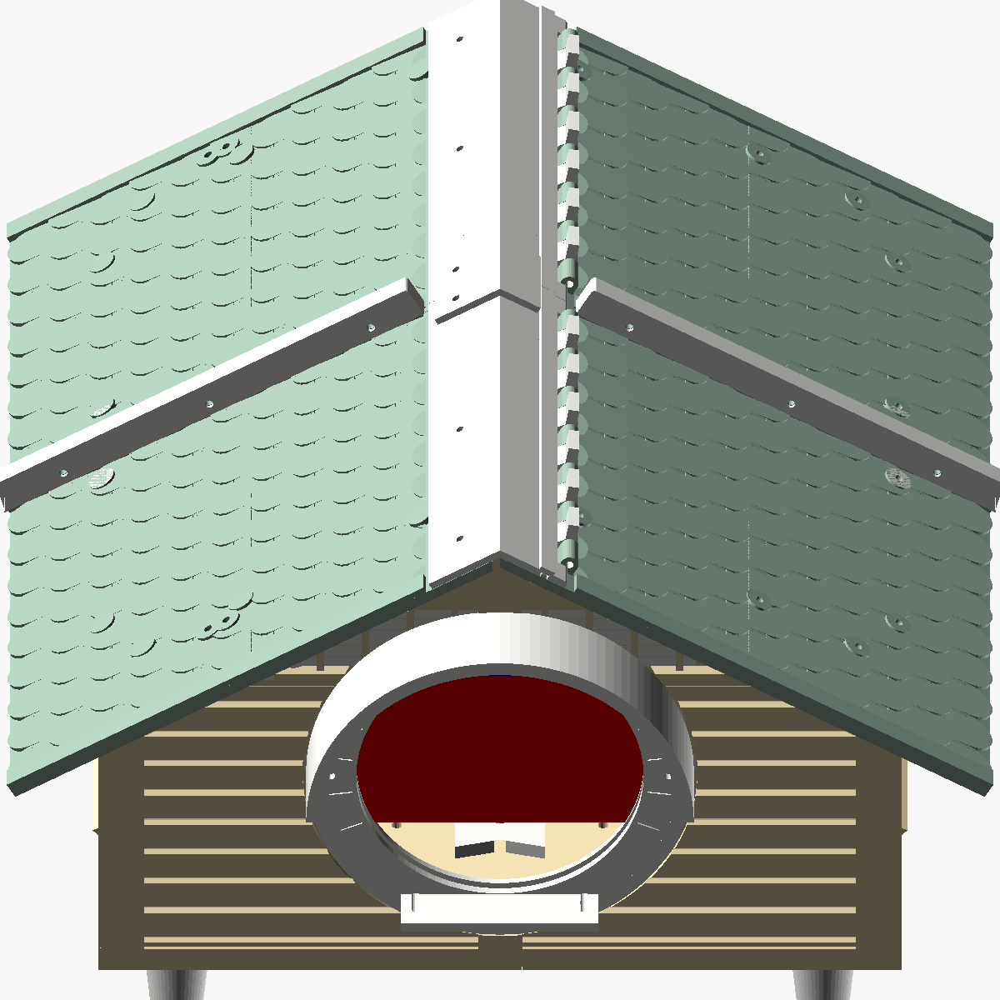

# Heavy-rain check

2026-11-23. A driven-rain line-of-sight test on the model, plus a check of the joints and drainage. It is
a geometric screening test, not a fluid simulation. Rain is treated as straight lines at the angle the wind
gives it. Splash, water running along surfaces and capillary creep are covered separately in the joints
section below.

## Short answer

| Where | Result |
|---|---|
| **Door, standard surround** | ❌ **Wind-driven rain from the front lands on the cushion.** With 100 mm/h of rain, about 2 L/h gets in at 22 mph wind and about 4 L/h at 43 mph. The hood and overhang only shelter the door from rain that falls nearly straight down. |
| **Door with the entrance tunnel** | ✅ Dry up to 22 mph from every direction. At 43 mph, about 0.17 L/h with the wind on the mouth's front corner. |
| Windows, wall louvres, gable louvres | ✅ Dry from every direction and angle tested |
| Escape hatch (back wall) | ✅ Dry from every direction and angle tested |
| Roof field, standing seams with caps | ✅ Dry |
| Ridge: joint between the front and back ridge caps and panels | ⚠️ A hairline (0.3 mm) gap is open to the sky for about 6 mm at the top of each standing seam and at the foot of the ridge saddle. It's tiny (about 1 mL/h in vertical rain), but it's a capillary path. Seal it with silicone during assembly. |
| Ridge cap leg on the lid side | ⚠️ The model has a 0.2 mm clearance under it. Bolted down it closes, but storm wind could push water up under it towards the lid's ridge edge. Seal the leg to the lid with silicone. |
| Floor | ✅ 124 drain holes, each able to drain about 5 mL/s, against at most about 1 mL/s coming in. The floor never pools. |

## Method

1. The room is lined with thin marker sheets:
   - **magenta:** the first 50 mm of the cushion top inside the door
   - **red:** the rest of the cushion top, and the inner walls above it
   - **blue:** the underside of the roof and the inside of the gables
2. Each view is an orthographic render looking exactly along the rain's path, so a pixel of marker colour is
   a straight line from the sky to the inside of the house. One pixel is 0.214 mm², calibrated with a
   100 × 100 mm plate.
3. **Cases:** vertical rain, plus 35°, 55° and 70° from vertical, each from 8 wind directions (front,
   front-right, right, back-right, back, back-left, left, front-left). For drops falling at about 7 m/s,
   those angles mean wind speeds of about 5, 10 and 19 m/s (11, 22 and 43 mph).
4. **Water in** = rainfall rate ÷ cos(angle) × opening area seen by the rain. Rainfall is 100 mm/h, a heavy
   Florida thunderstorm.

Run it again with `tools/rain_test.sh` (about 30 s). It writes the views and pixel counts to `tools/rain/`.

## Results: rain landing inside (house on legs, default settings)

| Wind direction | 35° (11 mph) | 55° (22 mph) | 70° (43 mph) |
|---|---|---|---|
| Front (at the door) | 4 150 mm² → **0.5 L/h** | 11 100 mm² → **1.9 L/h** | 14 500 mm² → **4.2 L/h** |
| Front-left or front-right | 660 mm² → 0.1 L/h | 4 560 mm² → **0.8 L/h** | 7 150 mm² → **2.1 L/h** |
| Left or right side | dry (screw-hole artifacts only, see below) | dry | dry |
| Back or back corners | dry | dry | dry |
| Vertical | ≈ 12 mm² at the ridge joint → about 1 mL/h | | |

Almost all the water that gets in lands past the first 50 mm, in the middle of the cushion and on the back
wall, not just on the door sill. A 30-minute storm burst with 22 mph wind straight at the door would put
about 1 L on the bed.

**Artifacts left out of the table:**
- From the right side, small hits line up with the eave roof screws. The test model has no screws in their
  holes; on the house each is filled by a screw with an EPDM washer.
- In the 70° front views, some door hits are counted as blue: the door's top edge is above the eave line,
  where the marker changes colour. They are included in the door figures.

## With the entrance tunnel

Same test with `door_tunnel = true`, mounted, mouth 150 mm along from the door centre. The results are the
same whichever way the tunnel faces (`tun_dir = "mount"` or `"away"`), mirrored.

| Wind | 35° (11 mph) | 55° (22 mph) | 70° (43 mph) |
|---|---|---|---|
| Front | dry | dry | dry |
| Front corner on the mouth's side | dry | dry | 600 mm² → 0.17 L/h |
| Other front corner, sides, back | dry | dry | dry |

Tunnel length, with the wind on the mouth's front corner at 70° (43 mph). All lengths are dry up to
22 mph, apart from a trace at 130:

| Mouth at | 130 mm | **150 mm (default)** | 170 mm | 200 mm |
|---|---|---|---|---|
| Water in | 0.32 L/h | **0.17 L/h** | 0.07 L/h | ≈ 0.001 L/h |

The lintel over the mouth (underside at 155 mm) is what stops near-horizontal rain skimming under the
tunnel roof to the doorway. Raising it to 160 mm let it back in.

## Joints and drainage (not covered by the line-of-sight test)

- **Roof field:** shingles shed downslope. The lid's storm-screw holes are blind (0.8 mm skin) until
  drilled.
- **Standing seams:** silicone between the upstands, then the printed cap over the top. Two seals in a
  row. ✅
- **Ridge on the hinge side:** the weather rib on the fixed slope sits in a groove under the cap, so water
  blown up the fixed slope can't reach the ridge gap. ✅
- **Ridge on the lid side:** the cap leg is bolted to the lid, but nothing seals it. Run a silicone bead
  along it (they never come apart). ⚠️
- **Seam ends near the ridge:** when running the silicone bead between the upstands, carry it on past the
  seam's top end to the panel's ridge edge, so the plain stretch under the ridge cap is sealed too. ⚠️
- **Lid edges:** EPDM foam tape on the gable rafters and the eave plate. ✅
- **Walls:** battens over the vertical seams, sloped tops on every ledge, and slanted louvres (outside
  lower than inside). ✅
- **Floor:** ribs keep the cushion off the slab, and 124 × 6 mm holes drain the channels. Any water that
  does get in drains out, but the cushion soaks it up first. ✅ for the house, ❌ for the bed.

## What to do about the door

In order of effect:

1. **Face the door away from the usual storm wind.** With the wind from the back or either side, the test
   found no rain getting in at any angle. Check which way storms usually come from where the house will
   stand.
2. **Fit the entrance tunnel** (`door_tunnel = true`, see the README). It keeps the door dry up to
   22 mph from every direction, with no flap for the cat to push.
3. **A deeper porch roof over the door** helps for moderate wind only. Stopping 55° rain would need a canopy
   reaching about 250 mm out from the door, which would change the cottage's look.
4. **A water-resistant cushion cover** (outdoor fabric, or a waterproof liner inside the cover) limits the
   damage when some rain gets in anyway.
