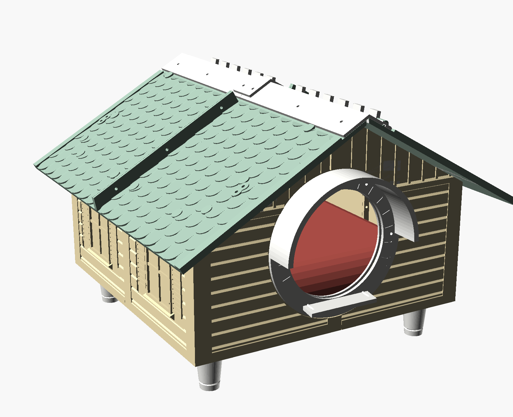
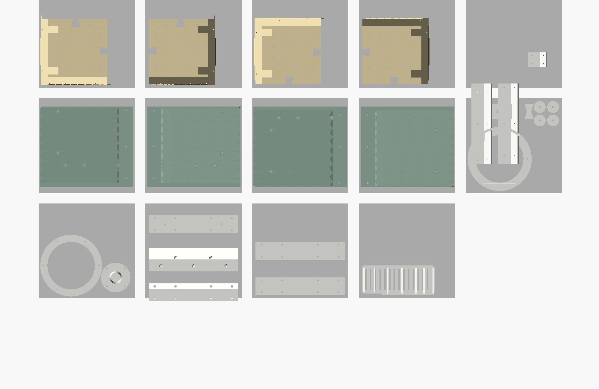

# Cat Cottage: a 3D-printable outdoor cat house

A parametric outdoor cat house in plain OpenSCAD, sized for a cat of about 5 kg. It looks like a small
cottage, with lap siding, board-and-batten gables, shuttered windows, a fish-scale shingle roof, and a
round entrance with a hood and step. It is built for Florida weather: UV, heat, humidity and
hurricane-season rain. Every part fits a **Bambu Lab H2D** on a single nozzle (325 × 320 × 325 mm), and
none needs supports.



| Gable end | Exploded |
|---|---|
|  |  |

| Fence mount | Tree mount |
|---|---|
|  |  |


## The cushion it is sized for

The defaults assume a **40 × 40 cm (16 in) square cushion or a 40 cm round pet bed**, up to about 10 cm
thick. The interior is 43 × 43 cm at the floor. That leaves 41 cm between the seam flanges, so a 40 cm bed
drops in with a little room. Inside height is 18 cm at the side walls and 30 cm under the ridge.

The cushion cannot pass through the 16 cm door. To wash it, take the roof off (see the assembly section).

For a different cushion, change `cushion_w`, `cushion_d` and `wall_h` in the **Cushion and interior**
group. The file stops with an error if a part would no longer fit the bed. Up to about 41 cm still fits;
for a 45 cm bed, set `pitch = 25` and `eave_ov = 35` so the corner modules and roof panels still fit.

## How it is built

- **Four corner modules.** Each prints upright and carries a quarter of the floor, half a front or back
  wall with half its gable, and half a side wall. They are 239 × 236 × 317 mm. At each seam, inner flanges
  bolt together. A printed batten covers the outside joint so rain can't run into it, and two bowtie
  (dovetail) keys lock the floor across each seam.
- **Four roof panels.** Each prints flat, with the shingles on top. The front and back panels on each
  slope bolt together along a standing seam. Each panel screws down into the gable walls and into corbels
  under the eaves.
- **Ridge cap (two pieces) and a saddle** over the joint between them.
- **Door surround** (hood, step and keystone) and an **inner ring**, which clamp the wall between them.
- **Four tapered corner legs and a centre leg.** They hold the floor 60 mm off the ground.
- **Optional mount**, chosen with `mount = "none" | "tree" | "fence"`. It goes on a long (eave) wall,
  the right one by default (`mount_side = "right" | "left"`). That leaves the door in the front gable, on
  the side next to the post or trunk, so a cat coming along the fence or down the tree can reach it.
  - *fence*: a French cleat. One half bolts to the house and the other screws to a post or rail. A
    standoff keeps the house plumb, and two long screws through it stop the house from lifting off in a
    storm.
  - *tree*: two rails with a V-groove that centres them on the trunk, and a channel each for a 25 mm
    ratchet strap or hose clamps.
  - A mounted house uses the `_mount` versions of the two right-hand corner modules and the two right-hand
    roof panels. Those corners have flat pads and bolt holes for the rails and no windows. Those roof
    panels have a 15 mm eave instead of 50 mm, so the roof clears the post or trunk.
  - **Landing ledge** (`landing = true`, on by default with a mount): a 95 mm wide shelf along the front
    wall at door-sill height. It runs from the mounting surface to the middle of the doorway, so the cat
    walks straight in. It never sticks out past the mounting surface, so the house still sits flat against
    a wall or fence board. Slots drain it and give paws some grip, and gussets underneath carry a landing
    cat. It bolts through the front wall with 3 × M5. With the ledge fitted, print `door_surround_mount`,
    which has no separate step.

### Weather details

- **Rain.** The roof overhangs 70 mm at the front, 35 mm at the back and 50 mm at the sides. Shingles
  shed water downslope. The standing seam and ridge cap cover the roof joints, and battens cover the wall
  seams. The entrance is shielded by the roof overhang, a 45 mm hood and a 40 mm sill, and its step slopes
  outward.
- **No water traps.** Every horizontal ledge (trim, window sills, drip caps, belt course) has a sloped top.
  The floor ribs keep the cushion off the floor, and 124 drain holes empty the channels between them.
  The floor sits 60 mm off the ground.
- **Heat.** Air comes in through the door and the floor holes and leaves high up: slanted louvres in the
  back gable, plus louvres under the side eaves where the overhang keeps rain out. Print the roof in a
  light colour.

## Files

| Path | What it is |
|---|---|
| `cat_house.scad` | The model. Its parameters are grouped and show in OpenSCAD's Customizer. |
| `build.sh` | Exports every STL to `stl/` and renders the previews in `renders/`. Run `./build.sh` (about 2 minutes). |
| `stl/` | One STL per part with the default settings, already in print orientation. |
| `renders/` | The preview images, including `plate_layout.png`, which shows how the parts fit on the build plates. |

To export one part from the command line:

```bash
/Applications/OpenSCAD-2021.01.app/Contents/MacOS/OpenSCAD -o stl/corner_fl.stl -D 'part="corner_fl"' cat_house.scad
```

## Parts list

| STL | Qty | Size (mm) | Orientation |
|---|---|---|---|
| `corner_fl`, `corner_fr` (or `corner_fr_mount`) | 1 each | 239 × 236 × 317 | as exported: floor down |
| `corner_bl`, `corner_br` (or `corner_br_mount`) | 1 each | 239 × 225 × 317 | as exported: floor down |
| `roof_fl`, `roof_bl`, `roof_fr`, `roof_br` (or `roof_fr_mount`, `roof_br_mount`, 275 long) | 1 each | 315 × 272 × 20 | as exported: shingles up |
| `ridge_front`, `ridge_back` | 1 each | 69 × 272 × 42 | as exported: one leg flat |
| `ridge_saddle` | 1 | 63 × 50 × 39 | as exported |
| `door_surround` | 1 | Ø216 × 50 | as exported: flange down, hood up |
| `door_inner_ring` | 1 | Ø208 × 4 | flat |
| `leg` | 4 | Ø40 × 60 | narrow end down |
| `center_leg` | 1 | Ø100 × 60 | as exported: plate down |
| `bowtie_key` | 4 | 50 × 30 × 10 | flat |
| `fence_house_cleat`, `fence_post_cleat`, `fence_standoff` | 1 each | 300 long | as exported (fence mount only) |
| `tree_rail` | 2 | 300 × 60 × 35 | as exported (tree mount only) |
| `landing` | 1 | 246 × 101 × 48 | as exported: walking surface down (any mount) |
| `door_surround_mount` | 1 | Ø216 × 50 | replaces `door_surround` when the landing is fitted |

See `renders/plate_layout.png` for how the parts fit on the plates.

### How much ASA to buy

These weights come from slicing every STL in Bambu Studio 2.x. The settings were the H2D 0.4 mm nozzle,
"0.20mm Standard @BBL H2D" with 4 walls, 5 top and 5 bottom layers, 15 % gyroid infill and a 5 mm brim, and
Bambu ASA on the textured PEI plate. Times are for that profile; a 0.6 mm nozzle on the big parts roughly
halves them.

| Build | Filament | Print time | Buy (1 kg spools, one colour) |
|---|---|---|---|
| On its legs (no mount) | 4.0 kg | ≈ 130 h | **5 spools** |
| Fence mount + landing ledge | 4.4 kg | ≈ 142 h | **5 spools** (6 to be safe) |
| Tree mount + landing ledge | 4.3 kg | ≈ 136 h | **5 spools** (6 to be safe) |

Splitting the colours the way the renders show takes more spools, because each colour has its own leftover:

| Colour | Parts | On legs | Fence + ledge | Tree + ledge |
|---|---|---|---|---|
| Walls (cream) | 4 corner modules | 2.33 kg → 3 spools | 2.29 kg → 3 spools | 2.29 kg → 3 spools |
| Roof (light sage) | 4 roof panels | 1.23 kg → 2 spools | 1.15 kg → 2 spools | 1.15 kg → 2 spools |
| Trim (white) | ridge, door, keys, legs, ledge, mount | 0.47 kg → 1 spool | 1.00 kg → 2 spools | 0.86 kg → 1 spool |

The heaviest single print is a back corner module at about 615 g and 18 h, so start each corner on a spool
with at least 700 g left. With the AMS's auto-refill, a second spool of the same ASA takes over if the first
runs out. The margins above cover a failed print or two and the purge lines. They don't cover a full
reprint of a corner module.



## Material and print settings

**Use ASA.** It holds up to Florida sun and heat: it keeps its colour and strength under UV, and it softens
only near 95–100 °C. PLA softens at about 55 °C, a temperature a dark part reaches in summer sun. PETG is
UV-tolerant but creeps under constant load and turns chalky, so treat it as a short-term stand-in only.
Pick light colours, because a white or pale roof runs much cooler than a dark one.

Starting settings for Bambu Studio (generic ASA profile on the H2D):

- Nozzle 0.4 mm at 0.20 mm layers, or **0.6 mm at 0.28 mm for the corners and roof panels** (much faster)
- 4 walls, 5 top and 5 bottom layers, 15–20 % gyroid infill
- Nozzle 260 °C, bed 100 °C, door closed, chamber heating on. Keep the cooling fan low (10–30 %) except on
  bridges.
- 5 mm brim on the corner modules and roof panels: ASA warps on large flat parts
- Supports off. Overhangs are 45° or steeper; the door top and the strap channel are short bridges.
- Dry the filament first (4 h at 65 °C) if the spool has been open in Florida humidity.

## Hardware (all stainless steel, A2/304 or better A4/316)

Stainless only: zinc-plated steel rusts and stains within a season near the coast.

| Qty | Part | Where |
|---|---|---|
| 15 | M4 × 20 button head + 2 washers + nyloc nut | Corner-module seams (3 per side seam, 3 front, 6 back) |
| 6 | M4 × 25 button head + washers + nyloc nut | Door surround and inner ring |
| 6 | M4 × 16 button head + washers + nyloc nut | Standing seams (3 per slope) |
| 8 | M4 × 16 button head + washers + nyloc nut | Ridge caps |
| 4 | M4 × 20 button head + washers + nyloc nut | Saddle, ridge caps and roof at the centre joint |
| 20 | #8 × 1" (4.2 × 25 mm) pan-head self-tapping screws with **bonded EPDM washers** (roofing screws) | Roof to gables (12) and eave corbels (8) |
| 4 | M6 × 70 flat (countersunk) head + M6 nut | Corner legs (the nut sits in the hex pocket in the foot) |
| 4 | M6 × 20 flat head + M6 nut | Centre leg |
| | Outdoor CA glue or epoxy | Bowtie keys (optional, they are a snug press fit) |

Fence mount: 16 × M5 × 20 button head + washers + nyloc nut, 5 × #10 × 1½" stainless countersunk
deck screws for the post cleat, and 2 × #10 × 3" (5 × 80 mm) stainless wood screws for the anti-lift
screws.

Landing ledge: 3 × M5 × 20 button head + washers + nyloc nut (heads inside the house).

Tree mount: 16 × M5 × 25 button head + washers + nyloc nut, and two 25 mm UV-resistant ratchet or cam
straps with stainless hardware (or stainless worm-drive hose clamps chained to the trunk's circumference).

## Assembly

1. **Test-fit.** Stand the four corner modules on a flat surface, push them together and check that the
   battens overlap their neighbours. Clean up any brim or elephant's foot on the seam faces.
2. **Floor keys.** Press the four bowtie keys into the pockets across the floor seams, adding a drop of
   glue if you like.
3. **Seams.** Bolt the inner flanges with M4 × 20 bolts: 3 per side seam, 3 at the front (below and above
   the door), and 6 at the back. Tighten them evenly so the battens close the outside gaps.
4. **Legs.** Drop the M6 × 70 countersunk bolts through the floor at the corners into the tapered legs,
   with the nut in the hex pocket under each foot. Bolt the centre leg under the middle of the floor with
   4 × M6 × 20.
5. **Door.** Hold the door surround outside with the hood on top, and the inner ring inside. Bolt them
   through the wall with 6 × M4 × 25. They also lock the front seam.
6. **Roof.** On each slope, bolt the front and back panels together through the standing seam
   (3 × M4 × 16). Set each slope on the house so its eave edge overhangs evenly. Then drive the 20 roofing
   screws through the bosses into the pilot holes: 3 into each gable top and 2 into the corbels under each
   eave per panel. Snug them so the EPDM washers just compress; don't crush them.
7. **Ridge.** Lay the two ridge caps along the peak and bolt them through the roof with M4 bolts. Put the
   saddle over the joint between them with the four M4 × 20 bolts. If you want the ridge fully sealed, run
   a thin bead of neutral-cure outdoor silicone along the panel tops before fitting the caps.
8. **Mount (optional).**
   - *Fence:* screw the post cleat level to the post or rail, with its bevel up and facing out. Bolt the
     house cleat (top) and standoff (bottom) to the right-hand wall. Hang the house on the cleat, then
     drive the two long screws from inside, through the wall and standoff, into the post.
   - *Landing:* bolt the ledge to the front-right corner module through the flat pad on the front wall
     (3 bolts) before you hang the house.
   - *Tree:* bolt both rails to the right-hand wall. Thread a strap through each rail's channel, set the V-grooves
     against the trunk and tighten the straps. Loosen them each season so the tree can grow.

To take the roof off for cleaning, remove the 20 roofing screws and lift the roof off as one piece. The
ridge caps and standing seams hold it together.

For a mount on the left wall, set `mount_side = "left"` and export `corner_fl`, `corner_bl`, `roof_fl` and
`roof_bl` with `-D 'mount="fence"' -D 'mount_side="left"'`. Either mount type gives the same parts.

## Placing it in Florida

- Put it in shade if you can. Face the entrance away from the prevailing wind and rain, and away from
  sprinklers.
- On the ground, use the legs on pavers or gravel rather than bare soil, so the floor drains and stays dry.
- **Hurricane watch:** bring it inside, or at least take the roof off and store it. A mounted house with its
  anti-lift screws will ride out ordinary summer storms, not a hurricane.
- Once a year, check the screws and straps, clear the drain holes and louvres, and wash it with mild soap.
  Avoid solvents on ASA.

## Notes

- Target printer: Bambu Lab H2D, single-nozzle build volume 325 × 320 × 325 mm (dual-nozzle printing
  shrinks X to 300 mm). The file checks every part against `bed`.
- Made with OpenSCAD 2021.01, no libraries.
