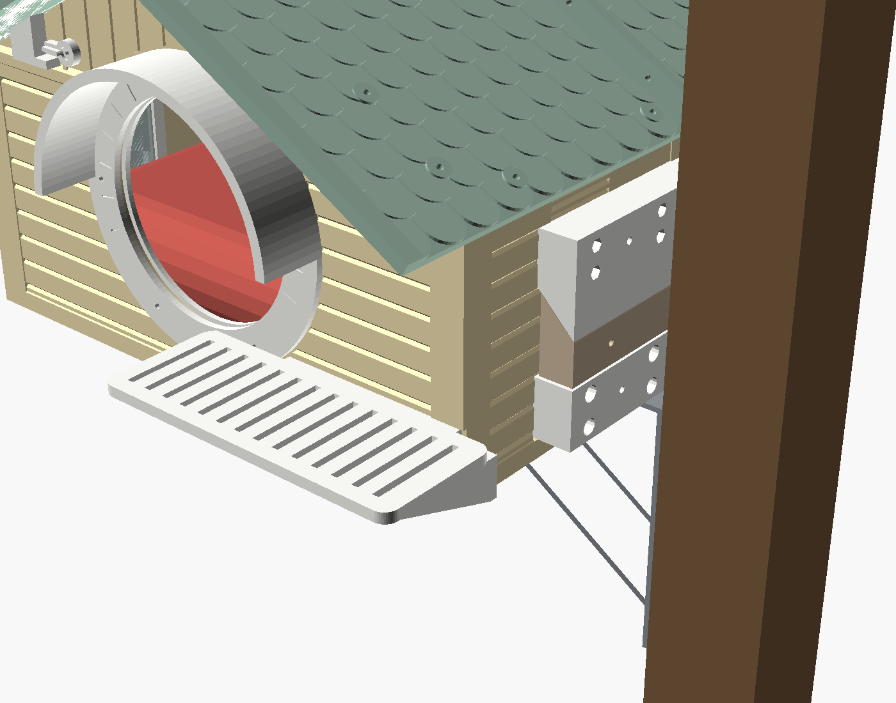

# Cat Cottage: a 3D-printable outdoor cat house

A parametric outdoor cat house in plain OpenSCAD, sized for a cat of about 5 kg. It looks like a small
cottage, with lap siding, board-and-batten gables, shuttered windows, a fish-scale shingle roof, and a
round entrance with a hood and step. It is built for Florida weather: UV, heat, humidity and
hurricane-season rain. Every part fits a **Bambu Lab H2D** on a single nozzle (325 × 320 × 325 mm), and
none needs supports.


| Gable end | Exploded |
|---|---|
|  |  |

| Fence mount | Tree mount |
|---|---|
|  |  |



## The cushion it is sized for

The defaults assume a **40 × 40 cm (16 in) square cushion or a 40 cm round pet bed**, up to about 10 cm
thick. The interior is 43 × 43 cm at the floor. That leaves 41 cm between the seam flanges, so a 40 cm bed
drops in with a little room. Inside height is 18 cm at the side walls and 30 cm under the ridge.

The cushion cannot pass through the 16 cm door. Instead, the left roof slope opens like a lid (see
[Opening the roof](#opening-the-roof)).

For a different cushion, change `cushion_w`, `cushion_d` and `wall_h` in the **Cushion and interior**
group. The file stops with an error if a part would no longer fit the bed. Up to about 41 cm still fits;
for a 45 cm bed, set `pitch = 25` and `eave_ov = 35` so the corner modules and roof panels still fit.

## How it is built

- **Four corner modules.** Each prints upright and carries a quarter of the floor, half a front or back
  wall with half its gable, and half a side wall. They are 239 × 236 × 317 mm. At each seam, inner flanges
  bolt together. A printed batten covers the outside joint so rain can't run into it, and two bowtie
  (dovetail) keys lock the floor across each seam.
- **Four roof panels.** Each prints flat, with the shingles on top. The front and back panels on each
  slope bolt together along a standing seam. Each panel screws down into the gable walls and into corbels
  under the eaves.
- **Ridge cap (two pieces) and a saddle** over the joint between them.
- **Door surround** (hood, step and keystone) and an **inner ring**, which clamp the wall between them.
- **Four tapered corner legs and a centre leg.** They hold the floor 60 mm off the ground.
- **Optional mount**, chosen with `mount = "none" | "tree" | "fence"`. It goes on a long (eave) wall,
  the right one by default (`mount_side = "right" | "left"`). That leaves the door in the front gable, on
  the side next to the post or trunk, so a cat coming along the fence or down the tree can reach it.
  - The house carries a **house cleat** (top) and a **standoff** (bottom). It hangs on a 45° French cleat,
    then 4 lock screws, driven from inside, fix it to the mounting surface.
  - *fence*: the **mount cleat** screws to a fence post, rail or wall.
  - *tree*: the **tree plate** (the mount cleat on a tall backing board) straps to the trunk with 3 ratchet
    straps or hose clamps. A V-groove on its back centres it on the trunk.
  - **Two steel shelf brackets under the floor are required when mounted.** Without them the floor centre
    is overstressed (see [STRUCTURAL.md](STRUCTURAL.md)). The brackets bolt through the centre-leg holes.
  - A mounted house uses the `_mount` versions of the two right-hand corner modules and the two right-hand
    roof panels. Those corners have flat pads and bolt holes for the cleat and standoff, and no windows.
    Those roof panels have a 15 mm eave instead of 50 mm, so the roof clears the post or trunk.
  - **Landing ledge** (`landing = true`, on by default with a mount): a 95 mm wide shelf along the front
    wall at door-sill height. It runs from the mounting surface to the middle of the doorway, so the cat
    walks straight in. It never sticks out past the mounting surface, so the house still sits flat against
    a wall or fence board. Slots drain it and give paws some grip, and gussets underneath carry a landing
    cat. It bolts through the front wall with 3 × M5. With the ledge fitted, print `door_surround_mount`,
    which has no separate step.

### Weather details

- **Rain.** The roof overhangs 70 mm at the front, 35 mm at the back and 50 mm at the sides. Shingles
  shed water downslope. The standing seam and ridge cap cover the roof joints, and battens cover the wall
  seams. The entrance is shielded by the roof overhang, a 45 mm hood and a 40 mm sill, and its step slopes
  outward.
- **No water traps.** Every horizontal ledge (trim, window sills, drip caps, belt course) has a sloped top.
  The floor ribs keep the cushion off the floor, and 124 drain holes empty the channels between them.
  The floor sits 60 mm off the ground.
- **Heat.** Air comes in through the door and the floor holes and leaves high up: slanted louvres in the
  back gable, plus louvres under the side eaves where the overhang keeps rain out. Print the roof in a
  light colour.

## Files

| Path | What it is |
|---|---|
| `cat_house.scad` | The model. Its parameters are grouped and show in OpenSCAD's Customizer. |
| `build.sh` | Exports every STL to `stl/` and renders the previews in `renders/`. Run `./build.sh` (about 2 minutes). |
| `stl/` | One STL per part with the default settings, already in print orientation. |
| `renders/` | The preview images, including `plate_layout.png`, which shows how the parts fit on the build plates. |

To export one part from the command line:

```bash
/Applications/OpenSCAD-2021.01.app/Contents/MacOS/OpenSCAD -o stl/corner_fl.stl -D 'part="corner_fl"' cat_house.scad
```

## Parts list

| STL | Qty | Size (mm) | Orientation |
|---|---|---|---|
| `corner_fl`, `corner_fr` (or `corner_fr_mount`) | 1 each | 239 × 236 × 320 | as exported: floor down |
| `corner_bl`, `corner_br` (or `corner_br_mount`) | 1 each | 239 × 225 × 320 | as exported: floor down |
| `roof_fl`, `roof_bl`, `roof_fr`, `roof_br` (or `roof_fr_mount`, `roof_br_mount`, 275 long) | 1 each | 315 × 272 × 20 | as exported: shingles up |
| `ridge_front`, `ridge_back` | 1 each | 80 × 57 × 272 | as exported: **standing on end** (the hinge knuckles print upright); use an 8 mm brim |
| `ridge_saddle` | 1 | 63 × 50 × 39 | as exported |
| `door_surround` | 1 | Ø216 × 50 | as exported: flange down, hood up |
| `door_inner_ring` | 1 | Ø208 × 4 | flat |
| `leg` | 4 | Ø40 × 60 | narrow end down |
| `center_leg` | 1 | Ø100 × 60 | as exported: plate down |
| `bowtie_key` | 4 | 50 × 30 × 13 | flat |
| `latch_keeper` | 2 | 36 × 34 × 12 | flat |
| `latch_button` | 2 | 30 × 18 × 9 | flat, grip up |
| `window_retainer` | 1 | 90 × 110 × 3 | flat |
| `fence_house_cleat`, `fence_standoff` | 1 each | 300 long | as exported (either mount) |
| `fence_post_cleat` | 1 | 300 × 58 × 26 | as exported (fence mount) |
| `tree_plate` | 1 | 300 × 308 × 51 | as exported: trunk side down (tree mount) |
| `landing` | 1 | 246 × 101 × 48 | as exported: walking surface down (any mount) |
| `door_surround_mount` | 1 | Ø216 × 50 | replaces `door_surround` when the landing is fitted |

See `renders/plate_layout.png` for how the parts fit on the plates.

### How much ASA to buy

These weights come from slicing every STL in Bambu Studio 2.x. The settings were the H2D 0.4 mm nozzle,
"0.20mm Standard @BBL H2D" with 4 walls, 5 top and 5 bottom layers, 15 % gyroid infill and a 5 mm brim, and
Bambu ASA on the textured PEI plate. Times are for that profile; a 0.6 mm nozzle on the big parts roughly
halves them.

| Build | Filament | Print time | Buy (1 kg spools, one colour) |
|---|---|---|---|
| On its legs (no mount) | 4.2 kg | ≈ 142 h | **5 spools** |
| Fence mount + landing ledge | 4.5 kg | ≈ 150 h | **5 spools** (6 to be safe) |
| Tree mount + landing ledge | 5.1 kg | ≈ 171 h | **6 spools** |

Splitting the colours the way the renders show takes more spools, because each colour has its own leftover:

| Colour | Parts | On legs | Fence + ledge | Tree + ledge |
|---|---|---|---|---|
| Walls (cream) | 4 corner modules | 2.41 kg → 3 spools | 2.39 kg → 3 spools | 2.39 kg → 3 spools |
| Roof (light sage) | 4 roof panels | 1.26 kg → 2 spools | 1.18 kg → 2 spools | 1.18 kg → 2 spools |
| Trim (white) | ridge, door, keys, latches, legs, ledge, mount | 0.52 kg → 1 spool | 0.92 kg → 1 spool | 1.49 kg → 2 spools |

The heaviest single prints are the tree plate (about 680 g, 25 h) and the back-left corner module
(about 640 g, 18.5 h), so start each of them on a spool with at least 750 g left. With the AMS's auto-refill, a second spool of the same ASA takes over if the first
runs out. The margins above cover a failed print or two and the purge lines. They don't cover a full
reprint of a corner module.


## Material and print settings

**Use ASA.** It holds up to Florida sun and heat: it keeps its colour and strength under UV, and it softens
only near 95–100 °C. PLA softens at about 55 °C, a temperature a dark part reaches in summer sun. PETG is
UV-tolerant but creeps under constant load and turns chalky, so treat it as a short-term stand-in only.
Pick light colours, because a white or pale roof runs much cooler than a dark one.

Starting settings for Bambu Studio (generic ASA profile on the H2D):

- Nozzle 0.4 mm at 0.20 mm layers, or **0.6 mm at 0.28 mm for the corners and roof panels** (much faster)
- 4 walls, 5 top and 5 bottom layers, 15–20 % gyroid infill
- Nozzle 260 °C, bed 100 °C, door closed, chamber heating on. Keep the cooling fan low (10–30 %) except on
  bridges.
- 5 mm brim on the corner modules and roof panels: ASA warps on large flat parts
- Supports off. Overhangs are 45° or steeper; the door top and the strap channel are short bridges.
- Dry the filament first (4 h at 65 °C) if the spool has been open in Florida humidity.

## Hardware (all stainless steel, A2/304 or better A4/316)

Stainless only: zinc-plated steel rusts and stains within a season near the coast.

| Qty | Part | Where |
|---|---|---|
| 15 | M4 × 20 button head + 2 washers + nyloc nut | Corner-module seams (3 per side seam, 3 front, 6 back) |
| 6 | M4 × 25 button head + washers + nyloc nut | Door surround and inner ring |
| 6 | M4 × 16 button head + washers + nyloc nut | Standing seams (3 per slope) |
| 4 | M4 × 16 button head + washers + nyloc nut | Ridge caps to the lid slope |
| 2 | M4 × 20 button head + washers + nyloc nut | Saddle, ridge caps and lid at the centre joint |
| 2 | M4 stainless threaded rod, 265 mm (or 4 mm stainless rod), + 4 acorn nuts + 4 washers | Hinge pins, one per ridge cap |
| 2 | M4 × 20 button head + washer + nyloc nut | Turn-button pivots (head inside the house) |
| 10 | #8 × 1" (4.2 × 25 mm) pan-head self-tapping screws with **bonded EPDM washers** (roofing screws) | Fixed slope to gables (6) and eave corbels (4) |
| 4 | #8 × 1" roofing screws with EPDM washers | Latch keepers to the lid (2 each) |
| (10) | #8 × 1" roofing screws, as above | Optional: screw the lid down too for hurricane season (drill out the bosses first) |
| 4 | M3 × 12 pan head + nut | Peek-window retainer |
| 1 | 2 mm UV-stabilised clear polycarbonate, cut to 77 × 97 mm | Peek-window pane |
| 2 m | Closed-cell EPDM foam tape, 10 × 3 mm, self-adhesive | Seal under the lid (gable rafters and eave plate) |
| | Clear neutral-cure outdoor silicone | Window pane bead |
| 4 | M6 × 70 flat (countersunk) head + M6 nut | Corner legs (the nut sits in the hex pocket in the foot); not needed when mounted |
| 4 | M6 × 20 flat head + M6 nut | Centre leg; not needed when mounted |
| | Outdoor CA glue or epoxy | Bowtie keys (optional, they are a snug press fit) |

Either mount: 16 × M5 × 20 button head + washers + nyloc nut (house cleat and standoff), and **2 steel
shelf brackets, 12 × 8 in (305 × 200 mm), heavy duty, each rated for at least 45 kg**, in stainless or
hot-dip galvanised steel. They bolt to the floor with 4 × M6 × 25 flat head + washers + nuts through the
centre-leg holes. Drill each bracket arm 6.5 mm at 216 and 276 mm from the inside face of its upright.

Fence mount: 4 × #10 × 1½" stainless countersunk screws for the mount cleat, 6 × #10 × 2" for the bracket
uprights, and 4 × #10 × 3" (5 × 80 mm) stainless wood screws as lock screws. Use large (25 mm) fender
washers inside the house.

Tree mount: 6 × M5 × 35 + nuts for the bracket uprights (the nuts sit in pockets on the trunk side), and
4 × #10 × 2¼" stainless screws as lock screws into the plate. Add three 25 mm UV-resistant ratchet straps
with stainless hardware, or stainless worm-drive hose clamps chained to the trunk's circumference.

Landing ledge: 3 × M5 × 20 button head + washers + nyloc nut (heads inside the house).

## Assembly

1. **Test-fit.** Stand the four corner modules on a flat surface, push them together and check that the
   battens overlap their neighbours. Clean up any brim or elephant's foot on the seam faces.
2. **Floor keys.** Press the four bowtie keys into the pockets across the floor seams, adding a drop of
   glue if you like.
3. **Seams.** Bolt the inner flanges with M4 × 20 bolts: 3 per side seam, 3 at the front (below and above
   the door), and 6 at the back. Tighten them evenly so the battens close the outside gaps.
4. **Legs (skip when mounted).** Drop the M6 × 70 countersunk bolts through the floor at the corners into the tapered legs,
   with the nut in the hex pocket under each foot. Bolt the centre leg under the middle of the floor with
   4 × M6 × 20.
5. **Peek window.** Run a thin bead of silicone round the pocket inside the front-left window, press
   the polycarbonate pane in, and clamp it with the printed retainer (4 × M3 × 12, heads outside in the
   window frame, nuts in the retainer's pockets). Wipe off any silicone that squeezes out.
6. **Door.** Hold the door surround outside with the hood on top, and the inner ring inside. Bolt them
   through the wall with 6 × M4 × 25. They also lock the front seam.
7. **Roof.** On each slope, bolt the front and back panels together through the standing seam
   (3 × M4 × 16). The right slope is fixed: set it so its eave overhangs evenly and drive its 10 roofing
   screws through the bosses into the pilot holes (3 into each gable top, 2 into the eave corbels per panel).
   Snug them so the EPDM washers just compress; don't crush them. The left slope is the lid: set it in
   place, but don't screw it down.
8. **Ridge and hinge.** Lay the two ridge caps along the peak so their knuckles mesh with the knuckles on
   the right slope. Slide a hinge pin (threaded rod) through each set from the gable end and cap both ends
   with washers and acorn nuts. Bolt the caps to the lid (left) slope only (4 × M4 × 16). Put the saddle
   over the joint between them and bolt its left leg (2 × M4 × 20).
9. **Seal and latches.** Stick the EPDM foam tape along the tops of the left-hand gable rafters and the
   left eave plate, where the lid rests. Screw each latch keeper under the lid's gable overhang, front and back (2 × #8 × 1"
   roofing screws each, through the bosses). Bolt a turn button to each gable wall, below and beside its
   keeper (M4 × 20, head inside the house, nyloc snug enough that the button stays where you turn it).
   Turned flat, the button's tongue presses the keeper's foot down about 1.5 mm, which compresses the foam
   and holds the lid down. Use a rubber or EPDM washer under each button and under each pivot bolt head.
10. **Mount (optional).**
     - Bolt the house cleat (top) and the standoff (bottom) to the right-hand wall, and the landing ledge to
      the front wall (3 bolts). No legs: print and fit none of them. The brackets use the centre-leg holes, and
      the four corner-leg holes stay open as extra drains.
    - *Fence:* screw the mount cleat level to the post, rail or wall, bevel up, with its high edge facing
      out.
    - *Tree:* put the bracket nuts into their pockets, then strap the tree plate to the trunk with the
      V-groove against the bark. Tension the 3 straps. Loosen them each season so the tree can grow.
    - Screw the two steel brackets' uprights to the post or plate, 60 mm apart and centred under where the
      cleat will be. Their arms' top edges must sit 61 mm below the bottom edge of the mount cleat
      (that's where the floor's underside lands). Easiest: hang the house first and mark.
    - Hang the house on the cleat, so the house cleat's lip drops behind the mount cleat. Bolt the bracket
      arms to the floor (4 × M6 × 25 through the centre-leg holes).
    - From inside, drive the 4 lock screws, with fender washers, through the wall into the post or plate:
      2 through the house cleat and 2 through the standoff.
    - Do the proof test in [STRUCTURAL.md](STRUCTURAL.md) before letting the cat in.

## Opening the roof


Turn both buttons up and lift the left eave. The whole left slope, with the ridge caps, swings up on the
hinge just below the ridge. Stop ears on the knuckles land on the fixed slope at about 120°, a little past
the balance point (about 111°), so the lid stays open on its own while you swap the cushion. It opens away
from the mount, so a post or tree is not in the way. To close it, lower the lid and turn the buttons flat.
The lid's ridge edge stops 4 mm short of the fixed slope so it clears as it swings; the ridge cap covers
that gap when closed.

For hurricane season, drill out the 10 blind bosses on the lid (4.8 mm) and drive the optional roofing
screws into them as well.

### Keeping the opening roof watertight

The lid is sealed the same way as the fixed roof, with no gap that faces the rain:

- **Ridge.** The ridge cap belongs to the lid and overlaps the fixed slope, so water runs off the cap,
  over the hinge knuckles and down the fixed slope. A 2 mm weather rib along the fixed slope sits in a
  groove under the cap, so wind-driven rain can't creep up under the cap to the ridge gap.
- **Gables and eave.** The lid overhangs every edge it sits on (70 mm at the front, 35 mm at the back,
  50 mm at the eave). The EPDM foam under it closes the joint, and the latches keep it compressed.
- **Holes.** Unused storm-screw holes in the lid are blind: a 0.8 mm printed skin closes them until you
  drill them out. The only holes through the lid are the four keeper screws, which have the same bosses
  and EPDM washers as the other roof screws. The turn-button pivots sit under the gable overhang, with
  rubber washers.
- **Hinge.** The knuckles sit on top of the fixed slope. Rain runs round them, and nothing under them
  leads indoors.

## Is the cat home?

The front window on the lid side (front left, when the mount is on the right) is a real, glazed peek
window. It is 70 × 90 mm, with the decorative mullions on the outside. It sits under the 50 mm eave with
a sloped sill, and from it you can see the cushion. The pane sits in a pocket inside the wall and is sealed
with silicone. Turn it off with `peek_window = false`.

Without looking in at all: a small battery presence sensor (a mmWave sensor that sees a sleeping cat, or
a PIR motion sensor) can be stuck under the ridge on the inside of the fixed slope. Pick one that runs on
batteries and talks to your phone. Nothing in the house needs to change for that.

If the mount is on the left wall (`mount_side = "left"`), the lid is the right slope instead. Export the
roof panels, ridge caps and latch parts with the same settings; the latch parts come out mirrored.

For a mount on the left wall, set `mount_side = "left"` and export `corner_fl`, `corner_bl`, `roof_fl`,
`roof_bl`, `landing` and `door_surround` with `-D 'mount="fence"' -D 'mount_side="left"'`. Either mount
type gives the same house parts.

## Strength

Checked by hand for a 20 kg load: on the floor, on the roof and on the ledge, standing on legs or mounted.
See [STRUCTURAL.md](STRUCTURAL.md). In short: on its legs it is fine as printed. **Mounted, it needs the two
steel brackets underneath.** Do the 20 kg proof test before first use.

## Placing it in Florida

- Put it in shade if you can. Face the entrance away from the prevailing wind and rain, and away from
  sprinklers.
- On the ground, use the legs on pavers or gravel rather than bare soil, so the floor drains and stays dry.
- **Hurricane watch:** bring it inside, or at least take the roof off and store it. A mounted house with its
  anti-lift screws will ride out ordinary summer storms, not a hurricane.
- Once a year, check the screws and straps, clear the drain holes and louvres, and wash it with mild soap.
  Avoid solvents on ASA.

## Notes

- Target printer: Bambu Lab H2D, single-nozzle build volume 325 × 320 × 325 mm (dual-nozzle printing
  shrinks X to 300 mm). The file checks every part against `bed`.
- Made with OpenSCAD 2021.01, no libraries.

## Licence

Cat Cottage is licensed under [Creative Commons Attribution-NonCommercial-ShareAlike 4.0
International (CC BY-NC-SA 4.0)](https://creativecommons.org/licenses/by-nc-sa/4.0/). You may print it,
share it and remix it with credit. You may not use it commercially, and remixes must use the same licence.
