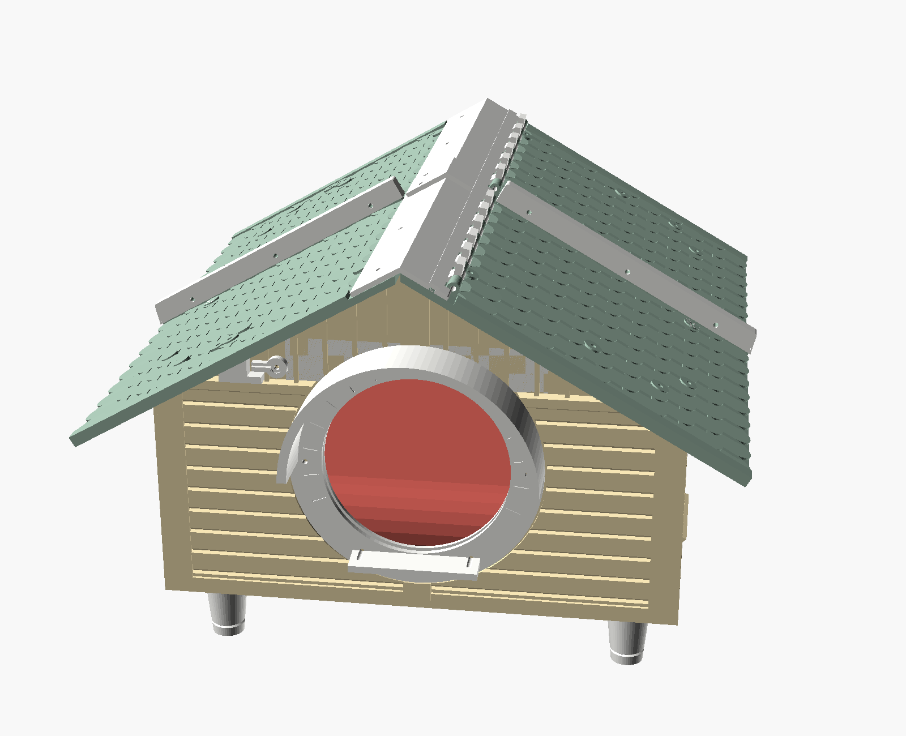
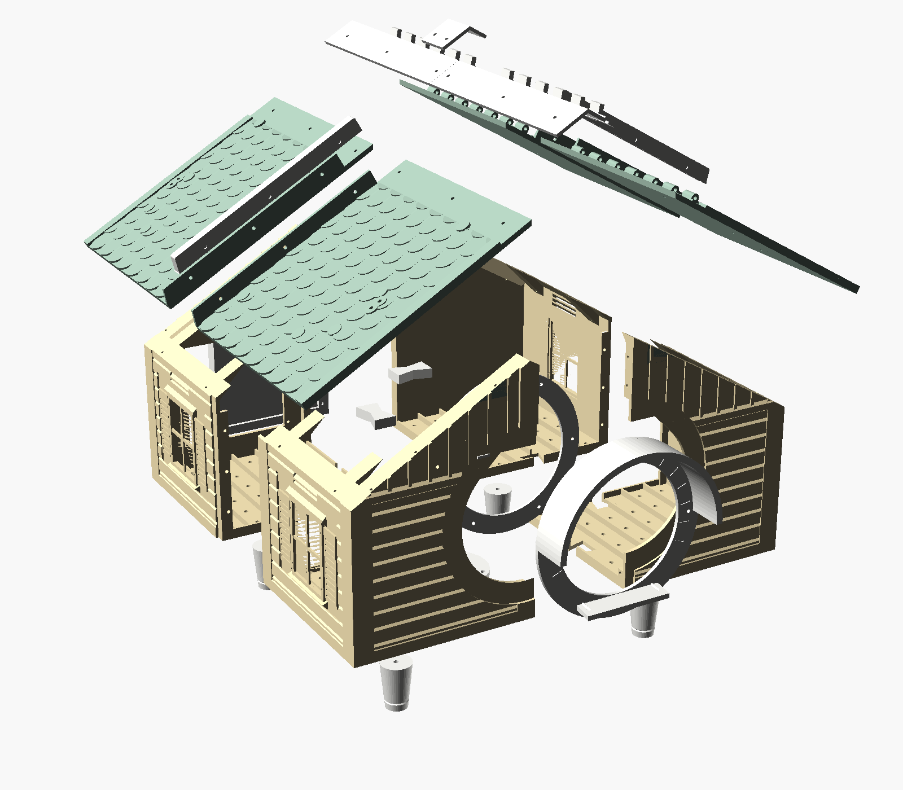
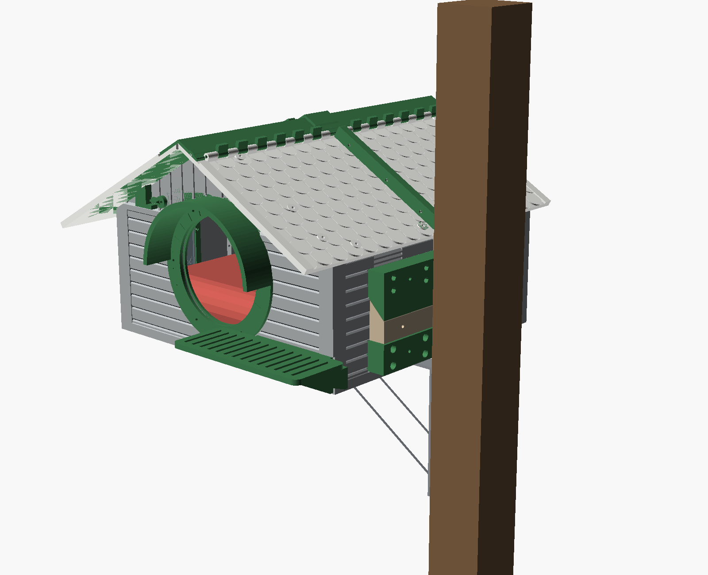
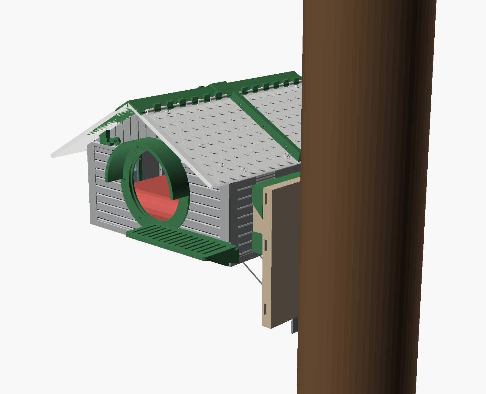
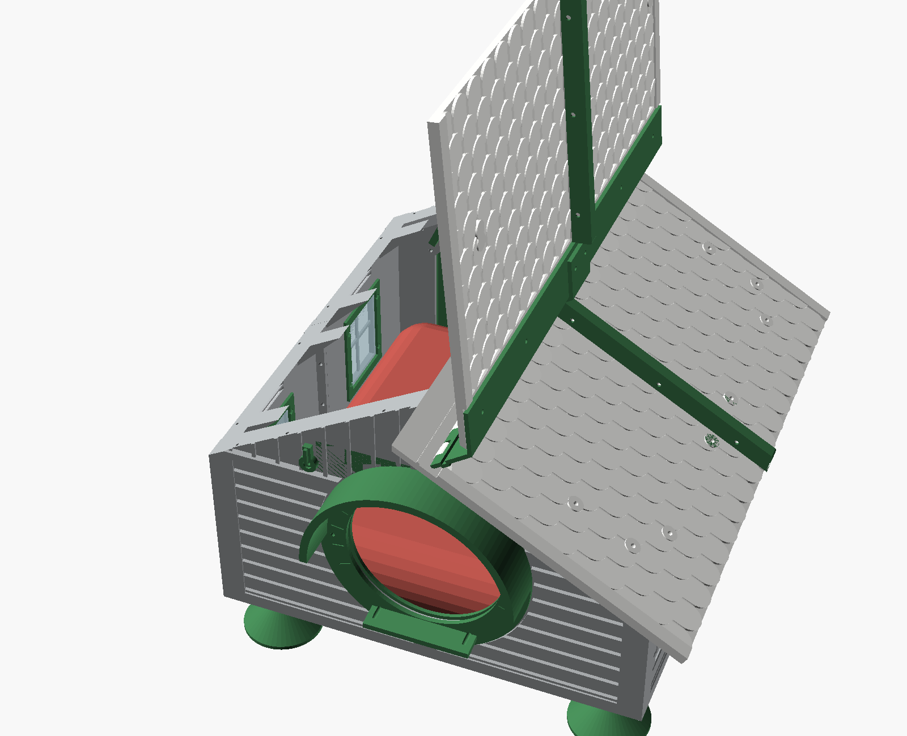
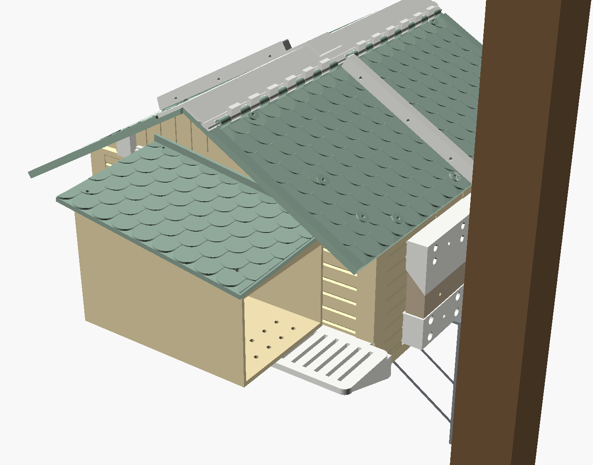
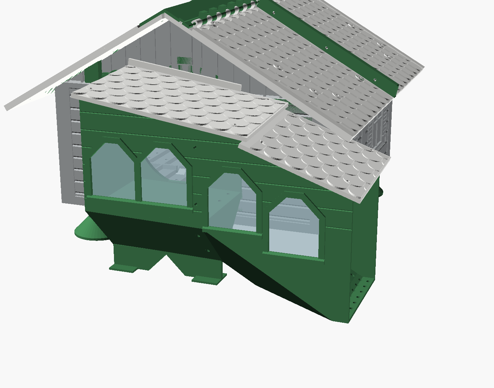
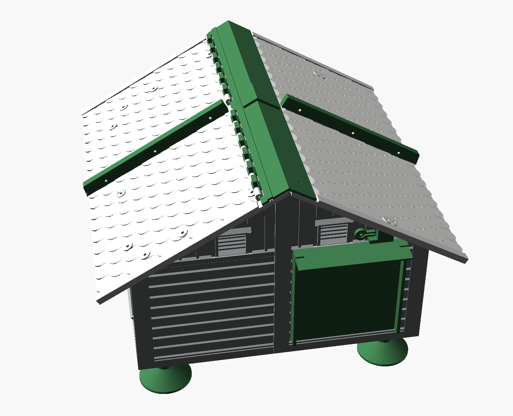

# Cat Cottage: a 3D-printable outdoor cat house

A parametric outdoor cat house in plain OpenSCAD, sized for a cat of about 5 kg. It looks like a small
cottage, with lap siding, board-and-batten gables, shuttered windows, a fish-scale shingle roof, and a
round entrance with a hood and step. It is built for Florida weather: UV, heat, humidity and
hurricane-season rain. Every part fits a **Bambu Lab H2D** on a single nozzle (325 × 320 × 325 mm). Only
three need supports: the ridge caps, the latch keepers and the escape-hatch flap.


| Gable end | Exploded |
|---|---|
|  |  |

| Fence mount | Tree mount |
|---|---|
|  |  |


## The cushion it is sized for

The defaults assume a **40 × 40 cm (16 in) square cushion or a 40 cm round pet bed**, up to about 10 cm
thick. The interior is 43 × 43 cm at the floor. That leaves 41 cm between the seam flanges, so a 40 cm bed
drops in with a little room. Inside height is 18 cm at the side walls and 30 cm under the ridge.

The cushion cannot pass through the 16 cm door. Instead, the left roof slope opens like a lid (see
[Opening the roof](#opening-the-roof)).

For a different cushion, change `cushion_w`, `cushion_d` and `wall_h` in the **Cushion and interior**
group. The file stops with an error if a part would no longer fit the bed. Up to about 41 cm still fits;
for a 45 cm bed, set `pitch = 25` and `eave_ov = 35` so the corner modules and roof panels still fit.

## How it is built

- **Four corner modules.** Each prints upright and carries a quarter of the floor, half a front or back
  wall with half its gable, and half a side wall. They are up to 239 × 236 × 320 mm. At each seam, inner flanges
  bolt together. A printed batten covers the outside joint so rain can't run into it, and two bowtie
  (dovetail) keys lock the floor across each seam.
- **Four roof panels.** Each prints flat, with the shingles on top. The front and back panels on each
  slope bolt together along a standing seam, under a printed seam cap. The fixed slope screws down into the
  gable walls and into corbels under the eaves. The other slope is a hinged lid held by two turn-button
  latches.
- **Ridge cap (two pieces) and a saddle** over the joint between them.
- **Door surround** (hood, step and keystone) and an **inner ring**, which clamp the wall between them.
- **Four legs and a centre leg**, with wide 84 mm feet for sand or soil. They hold the floor 60 mm off the
  ground.
- **Optional entrance tunnel** with a corner, which keeps wind-driven rain off the cushion (see
  [Entrance tunnel](#entrance-tunnel-optional)).
- **Optional mount**, chosen with `mount = "none" | "tree" | "fence"`. It goes on a long (eave) wall,
  the right one by default (`mount_side = "right" | "left"`). That leaves the door in the front gable, on
  the side next to the post or trunk, so a cat coming along the fence or down the tree can reach it.
  - The house carries a **house cleat** (top) and a **standoff** (bottom). It hangs on a 45° French cleat,
    then 4 lock screws, driven from inside, fix it to the mounting surface.
  - *fence*: the **mount cleat** screws to a fence post, rail or wall.
  - *tree*: the **tree plate** (the mount cleat on a tall backing board) straps to the trunk with 3 ratchet
    straps or hose clamps. A V-groove on its back centres it on the trunk.
  - **Two shelf brackets under the floor are required when mounted.** Without them the floor centre
    is overstressed (see [STRUCTURAL.md](STRUCTURAL.md)). The brackets bolt through the centre-leg holes.
    Use bought steel brackets, or print the optional `support_bracket` (2 needed; see
    [Printed support brackets](#printed-support-brackets-optional)).
  - A mounted house uses the `_mount` versions of the two right-hand corner modules and the two right-hand
    roof panels. Those corners have flat pads and bolt holes for the cleat and standoff, and no windows.
    Those roof panels have a 15 mm eave instead of 50 mm, so the roof clears the post or trunk.
  - **Landing ledge** (`landing = true`, on by default with a mount): a 95 mm wide shelf along the front
    wall at door-sill height. It runs from the mounting surface to the middle of the doorway, so the cat
    walks straight in. It never sticks out past the mounting surface, so the house still sits flat against
    a wall or fence board. Slots drain it and give paws some grip, and gussets underneath carry a landing
    cat. It bolts through the front wall with 3 × M5. With the ledge fitted, print `door_surround_mount`,
    which has no separate step.
  - **Mount on the left wall** (`mount_side = "left"`): the lid is then the right slope, and everything is
    mirrored. Export the house parts with `-D 'mount="fence"' -D 'mount_side="left"'` (either mount type
    gives the same house parts), including the roof panels, ridge caps and latch parts.

### Weather details

- **Rain.** The roof overhangs 70 mm at the front, 35 mm at the back and 50 mm at the sides. Shingles
  shed water downslope. Each standing seam is sealed with silicone between its two upstands and covered by a
  printed seam cap, so rain can't reach the joint from above. The ridge cap covers the ridge, and battens cover the wall
  seams. The entrance is shielded by the roof overhang, a 45 mm hood and a 40 mm sill, and its step slopes
  outward.
- **No water traps.** Every horizontal ledge (trim, window sills, drip caps, belt course) has a sloped top.
  The floor ribs keep the cushion off the floor, and 124 drain holes empty the channels between them.
  The floor sits 60 mm off the ground.
- **Heat.** Air comes in through the door and the floor holes and leaves high up: slanted louvres in the
  back gable, plus louvres under the side eaves where the overhang keeps rain out. Print the roof in a
  light colour.

## Files

| Path | What it is |
|---|---|
| `cat_house.scad` | The model. Its parameters are grouped and show in OpenSCAD's Customizer. |
| `build.sh` | Exports every STL to `stl/` and renders the previews in `renders/`. Run `./build.sh` (about 2 minutes). |
| `stl/` | One STL per part with the default settings, already in print orientation. |
| `renders/` | The preview images, including `plate_layout.png`, which shows how the parts fit on the build plates. |
| `release/` | Ready-made Bambu Studio project files: per colour for the on-legs build with the tunnel, generic ones per build, and the test prints. All are set up for the 0.6 mm nozzle. |
| `STRUCTURAL.md`, `RAIN.md` | Strength checks for a 20 kg load, and the driven-rain check. |
| `tools/` | The rain test, the test-print coupons, and the scripts that build the slicer profiles and fix the project files. |

To export one part from the command line:

```bash
/Applications/OpenSCAD-2021.01.app/Contents/MacOS/OpenSCAD -o stl/corner_fl.stl -D 'part="corner_fl"' cat_house.scad
```

## Parts list

Sizes are as printed (mm), from the exported STLs. Print each part as exported unless the table says
otherwise. The `stl/` folder holds every variant; pick the tables that match your build.

### Every build

| STL | Qty | Size | Orientation and notes |
|---|---|---|---|
| `corner_fl` | 1 | 239 × 236 × 320 | floor down (with the tunnel on a wall: `corner_fl_away`, see below) |
| `corner_bl` | 1 | 239 × 225 × 320 | floor down; carries the escape-hatch opening |
| `roof_fl`, `roof_bl` | 1 each | 311 × 272 × 26 | shingles up; the lid slope (no screw pads) |
| `ridge_front`, `ridge_back` | 1 each | 72 × 57 × 272 | **standing on end**, built-in lattices under the knuckles, 10 mm brim; or both as one object, `ridge_pair` (72 × 157 × 272) |
| `ridge_saddle` | 1 | 55 × 50 × 25 | as exported |
| `door_inner_ring` | 1 | Ø208 × 4 | flat |
| `bowtie_key` | 4 | 50 × 30 × 13 | flat |
| `latch_keeper` | 2 | 36 × 34 × 12 | flat |
| `latch_button` | 2 | 30 × 18 × 9 | flat, grip up |
| `hatch_frame` | 1 | 170 × 174 × 43 | wall side down, hood and cheeks up |
| `hatch_flap` | 1 | 157 × 164 × 12 | inside face down |

### On legs

| STL | Qty | Size | Orientation and notes |
|---|---|---|---|
| `corner_fr`, `corner_br` | 1 each | 227 × 236 × 320, 227 × 225 × 320 | floor down; windows on both sides |
| `roof_fr`, `roof_br` | 1 each | 315 × 272 × 26 | shingles up; the fixed slope, with the hinge knuckles |
| `seam_cap` | 2 | 270 × 13 × 19 | top down, open side up |
| `leg` | 4 | Ø84 × 60 | wide foot down (`leg_foot_d = 0` for the original narrow foot), 6 mm brim |
| `center_leg` | 1 | Ø100 × 60 | plate down; its 84 mm foot widens at 45° |
| `window_retainer` | 4 | 90 × 110 × 3 | flat, one per window |
| `door_surround` | 1 | Ø216 × 50 | flange down, hood up; not with the tunnel |

### Mounted (post, tree or wall)

| STL | Qty | Size | Orientation and notes |
|---|---|---|---|
| `corner_fr_mount`, `corner_br_mount` | 1 each | 224 × 236 × 320, 224 × 225 × 320 | floor down; pads and bolt holes for the cleat, no windows |
| `roof_fr_mount`, `roof_br_mount` | 1 each | 275 × 272 × 26 | shingles up; 15 mm eave so the roof clears the post |
| `seam_cap`, `seam_cap_mount` | 1 each | 270 × 13 × 19, 229 × 13 × 19 | top down, open side up |
| `window_retainer` | 2 | 90 × 110 × 3 | flat, one per window |
| `fence_house_cleat`, `fence_standoff` | 1 each | 300 × 68 × 30, 300 × 44 × 30 | as exported |
| `fence_post_cleat` | 1 | 300 × 58 × 26 | post, fence or wall |
| `tree_plate` | 1 | 300 × 308 × 51 | trunk side down; instead of `fence_post_cleat` for a tree |
| `landing` | 1 | 241 × 101 × 51 | walking surface down |
| `door_surround_mount` | 1 | Ø216 × 50 | flange down; no step, the landing replaces it; not with the tunnel |
| `support_bracket` | 2 | 200 × 300 × 36 | optional, instead of steel shelf brackets: web down, 6 walls, 40 % infill |

### Entrance tunnel (optional, replaces the door surround)

| Build | STL | Qty | Size | Orientation and notes |
|---|---|---|---|---|
| On legs | `tunnel_body` | 1 | 180 × 164 × 291 | the landing; keel legs down |
| | `tunnel_ramp` | 1 | 225 × 163 × 263 | the ramp; ramp foot down |
| | `tunnel_roof` | 1 | 256 × 176 × 16 | shingles up |
| | `tunnel_ramp_roof` | 1 | 173 × 176 × 9 | shingles up |
| Mounted on a post or tree | `tunnel_body_mount` | 1 | 240 × 161 × 178 | floor down |
| | `tunnel_roof` | 1 | 256 × 176 × 16 | shingles up |
| Mounted on a wall | `tunnel_body_away`, `tunnel_roof_away` | 1 each | 240 × 161 × 178, 256 × 176 × 16 | the tunnel on the free side of the door |
| | `landing_away` | 1 | 292 × 101 × 58 | instead of `landing`: runs past the corner as a porch |
| | `corner_fl_away` | 1 | 239 × 236 × 320 | instead of `corner_fl`: has the landing's bolt holes |

See `renders/plate_layout.png` for how the parts fit on the plates.

### How much ASA to buy

These weights come from slicing every STL in Bambu Studio 2.x (re-sliced 2026-11-26 with all current parts). The settings were the H2D 0.4 mm nozzle,
"0.20mm Standard @BBL H2D" with 4 walls, 5 top and 5 bottom layers, 15 % gyroid infill and a 5 mm brim, and
Bambu ASA on the textured PEI plate. Times are for that profile; a 0.6 mm nozzle on the big parts roughly
halves them.

| Build | Filament | Print time | Buy (1 kg spools, one colour) |
|---|---|---|---|
| On its legs (no mount) | 4.4 kg | ≈ 150 h | **5 spools** |
| Fence mount + landing ledge | 4.6 kg | ≈ 154 h | **5 spools** (6 to be safe) |
| Tree mount + landing ledge | 5.2 kg | ≈ 175 h | **6 spools** |
| Printed support brackets (optional, 2; 6 walls, 40 % infill) | +0.51 kg | +≈ 21 h | add 1 spool |
| Entrance tunnel on legs (landing, ramp and both roofs, less the door surround) | +1.24 kg | +≈ 45 h | add 2 spools |
| Entrance tunnel, mounted (body and roof, less the door surround) | +0.47 kg | +≈ 14 h | add 1 spool (the wall layout's longer landing adds 40 g) |

Splitting the colours the way the renders show takes more spools, because each colour has its own leftover:

| Colour | Parts | On legs | Fence + ledge | Tree + ledge |
|---|---|---|---|---|
| Walls (grey) | 4 corner modules | 2.25 kg → 3 spools | 2.26 kg → 3 spools | 2.26 kg → 3 spools |
| Roof (white) | 4 roof panels | 1.26 kg → 2 spools | 1.18 kg → 2 spools | 1.18 kg → 2 spools |
| Trim (green) | ridge, seam caps, door, keys, latches, windows, hatch, legs, ledge, mount | 0.86 kg → 1 spool | 1.13 kg → 2 spools | 1.70 kg → 2 spools |

With the tunnel, its walls are printed in the trim colour and its roofs with the roof: on legs 1.08 kg trim and
0.27 kg roof, mounted 0.42 kg trim and 0.17 kg roof. On legs that means a 2nd trim spool.

The heaviest single prints are the tree plate (about 680 g, 25 h) and the back-right corner module
(about 610 g, 17.5 h), so start each of them on a spool with at least 750 g left. With the AMS's auto-refill, a second spool of the same ASA takes over if the first
runs out. The margins above cover a failed print or two and the purge lines. They don't cover a full
reprint of a corner module.


## Material and print settings

**Use ASA.** It holds up to Florida sun and heat: it keeps its colour and strength under UV, and it softens
only near 95–100 °C. PLA softens at about 55 °C, a temperature a dark part reaches in summer sun. PETG is
UV-tolerant but creeps under constant load and turns chalky, so treat it as a short-term stand-in only.
Pick light colours, because a white or pale roof runs much cooler than a dark one. The renders and project
files use a white roof, grey walls and green trim; the walls take more sun than the trim, so they get the
lighter of the two.

Starting settings for Bambu Studio (generic ASA profile on the H2D):

- Nozzle 0.4 mm at 0.20 mm layers, or **0.6 mm at 0.30 mm** (a third faster; every project file in `release/` uses 0.6)
- 4 walls, 5 top and 5 bottom layers, 15–20 % gyroid infill
- Nozzle 260 °C, bed 100 °C, door closed, chamber heating on. Keep the cooling fan low (10–30 %) except on
  bridges.
- 5 mm outer brim on every part, because ASA warps. **Brim rule:** a part taller than 100 mm whose first
  layer covers less than 40 % of its footprint gets 8 mm, and less than 15 % gets 10 mm. That's the on-legs
  landing (291 mm tall on 12 %: two pads, the keel and the outriggers' feet) and the ridge caps (272 mm on 8 %)
  at 10 mm, and the ramp (263 mm on 38 %) at 8 mm. The legs keep 6 mm. The project files set these on the
  parts themselves (`BRIM` in `tools/fix_3mf.py`).
- **Cooling filter on** (printer settings). ASA gives off styrene, so keep the door closed and let the
  printer filter the air. On the H2D this printer setting is the one that counts; the filament's "air
  filtration" option (on in Bambu ASA's profile, exhaust fan 70 %) applies to printers that support it.
  The project files have both switched on.
- **No slicer supports.** The supports are built into the parts and print with them:
  - thin combs under the corner modules' window heads (70 mm), the escape-hatch top (98 mm) and the half
    door top on each front corner (35 mm, free at the seam);
  - a comb under the entrance tunnel's lintel (80 mm), on the ramp and on the mounted tunnel bodies;
  - outriggers that steady the on-legs landing, which stands on its narrow keel;
  - small lattices under the ridge caps' hinge knuckles and stop ears.
  Each stops one 0.30 mm layer short of the surface it holds and 1 mm from the sides, so it doesn't fuse, and
  stands on small tabs. After printing, snip the tabs with flush cutters and lift or twist the comb out. Bambu
  Studio still shades those surfaces red in its overhang preview; that's expected, leave supports off.
- **Design rule for every part:** a flat underside may bridge at most 40 mm, which is Bambu's figure for ASA
  (community tests see sag start at about 40 mm), and any flat with a free end longer than about 3 mm needs
  holding up. Where a surface can be reshaped to 45° without hurting the design it is; otherwise it gets a
  breakaway comb. `print_supports = false` in `cat_house.scad` leaves the combs out, for another slicer's own
  supports.
- Dry the filament first (4 h at 65 °C) if the spool has been open in Florida humidity.

## Test print first

Before the big parts, print `release/cat_cottage_H2D_test_coupons.3mf` with the nozzle you'll use for the
house. It's one plate: about 110 g and 2.6 h with a 0.6 mm nozzle. It holds small pieces cut from the real parts, in their real print
orientation, so they show whether the joints fit on your printer and filament:

| Pieces | Check | If it's off, change in `cat_house.scad` |
|---|---|---|
| `seam_front`, `seam_back`, `seam_cap_slice` | Push the two upstands together and slide the cap over them. Bolt through all three with an M4 × 20. The upstands should meet flat, and the cap should slide on firmly without rocking. | `gap` (seam clearance, 0.15 per side), `seam_cap_cl` (now 0.15) |
| `hinge_panel`, `hinge_cap` | Mesh the knuckles and push an M4 rod or a long M4 bolt through. It should swing freely, and the stop ears should land at about 118°. | `hinge_gap` (0.6), `hinge_pin` (4.5 hole), `hinge_stop` (134) |
| `key_left`, `key_right`, `bowtie_key` | Press the key into both pockets: the two halves should close with no gap and no play. | the pockets' 0.15 offset and the key's size (`bowtie_key`, now drawn size) |
| `latch_button`, `latch_keeper` | Bolt the button on an M4 with a washer and nyloc nut: it should turn with a little friction and hold its position. | |

If something is too tight or too loose, measure the gap with a feeler gauge or calipers, change the value,
and rebuild the parts that use it with `./build.sh stl`.

**First test print (2026-11-25, 0.6 mm nozzle):** print quality was good, and three things changed:

| Check | Result | Change |
|---|---|---|
| Seam cap | 0.8 mm of side-to-side play: too loose | `seam_cap_cl` 0.4 → 0.15 mm per side |
| Hinge | Wouldn't mesh: the fixed slope's gable screw nearest the ridge put its pad under the ridge cap's knuckles. The full roof had the same clash. | That screw is gone (the fixed slope keeps 8). Also, the stop ears were landing at about 109°, before the lid's 111° balance point, so `hinge_stop` 126 → 134: the lid now rests open at about 118°. |
| Floor key | Flush, but sliding with 0.8 mm of play. Made 0.35 mm wider per side, it then held the halves 1 mm apart: the dovetail's 16° sides turn each 0.1 mm of width into about 0.5 mm along the seam. | The key is now at its drawn size, halfway between the two (the pockets are unchanged). `release/cat_cottage_H2D_test_key.3mf` prints one key in about 12 minutes to check. |

Second test print: the seam cap and hinge passed. Third: the key at its drawn size fits flush, with the halves
closed and no play. **All joints pass.** `release/cat_cottage_H2D_test_coupons_retest.3mf` reprints just the changed pieces: seam-cap slice, hinge
panel, hinge cap and key. That's about 80 g and 2 h, using the first print's seam edges and floor
pockets.

**Breakaway supports (2026-11-26):** before the first corner, print `release/cat_cottage_H2D_test_breakaway.3mf`
(16 g, about 35 minutes, grey, supports off). It's a 70 mm opening whose head stands on the same comb as the
window heads. Snip the tabs, then twist the comb out.

| Check | If it's off, change in `cat_house.scad` |
|---|---|
| The comb comes away by hand, without tearing the head | fused: `bk_gap` 0.3 → 0.4 (and check the slicer's layer height is 0.30) |
| The head's underside is flat between the comb's lines, sagging no more than about 0.5 mm | sagging: `bk_pitch` 7 → 5 |
| The comb's ends didn't stick to the sides of the opening | stuck: `bk_side` 1 → 1.5 |
| The comb stood up straight to the top | wobbled: tell me, the spine can be doubled |

First print (2026-11-26, 0.6 mm nozzle): the comb came off clean. No change needed.

The coupons' STLs are in `stl/test/`, and `tools/test_coupons.scad` makes them. The slicer profiles behind
the project files come from `tools/flatten_profiles.py`. After exporting project files from the command
line, run `python3 -I tools/fix_3mf.py release/*.3mf`. It records which settings differ from Bambu's
built-in profile, which Bambu Studio needs in order to keep them, and keeps slicer supports off (only the
hinge coupon, which predates the built-in supports, gets them). After changing a part, `./build.sh stl` and
then `python3 -I tools/swap_meshes.py release/<file>.3mf` put the new mesh into a project file without moving
anything on its plates; run `fix_3mf.py` on it afterwards. `tools/breakaway_test.scad` makes the breakaway
test piece.

## Print order: on legs, three colours, with the entrance tunnel

These files are set up for a **0.6 mm nozzle**: "0.30mm Standard @BBL H2D 0.6 nozzle", 4 walls (3 for the corners), 15 %
gyroid, 5 top and bottom layers, Bambu ASA, textured PEI plate. There is one project file per colour, so a
plate never changes filament part-way through. None of them needs slicer supports: the supports are built
into the parts (see Material and print settings), so leave supports off. The generic files (`on_legs`, `mounted`, `entrance_tunnel`, `printed_brackets`) use the same 0.6 mm profile
(the brackets with 6 walls and 40 % infill).

| Order | File | Colour | Plates | ASA | Time |
|---|---|---|---|---|---|
| 1 | `cat_cottage_H2D_test_coupons.3mf` | white | 1 | 0.12 kg | ≈ 2.7 h |
| 1b | `cat_cottage_H2D_test_breakaway.3mf`: a 70 mm head on a built-in comb, to check the supports snap off cleanly | grey | 1 | 16 g | ≈ 35 min |
| 2 | `cat_cottage_H2D_on_legs_walls.3mf`: 4 corner modules, **3 walls**, with built-in combs under the window heads, the hatch top and the door top | grey | 4 | 2.62 kg | ≈ 46 h |
| 3 | `cat_cottage_H2D_on_legs_tunnel_roof.3mf`: 4 roof panels, then both tunnel roofs | white | 6 | 2.01 kg | ≈ 36 h |
| 4 | `cat_cottage_H2D_tunnel_body.3mf`: the on-legs tunnel's landing (with outriggers, 10 mm brim) and ramp extension (comb under the lintel, 8 mm brim) | green | 2 | 1.36 kg | ≈ 24.5 h |
| 5 | `cat_cottage_H2D_trim1_ridge_caps.3mf`: both ridge caps standing on end, with built-in lattices under the knuckles and a 10 mm brim | green | 1 | 0.22 kg | ≈ 5.2 h |
| 6 | `cat_cottage_H2D_trim2_supported.3mf`: latch keepers, hatch frame, hatch flap (they no longer need supports; the name stays) | green | 2 | 0.19 kg | ≈ 3 h |
| 7 | `cat_cottage_H2D_trim3_small.3mf`: ridge saddle, seam caps, wide-foot legs, keys, latch buttons, window retainers, inner door ring | green | 3 | 0.48 kg | ≈ 8.6 h |

| Colour | Needed | Spools on hand | Spare |
|---|---|---|---|
| White: roof, tunnel roofs, test pieces | 2.1 kg | 4 | ≈ 1.9 kg |
| Grey: 4 corner modules, breakaway test | 2.65 kg | 3 | ≈ 0.35 kg |
| Green: trim and tunnel | 2.25 kg | 3 | ≈ 0.75 kg |

In all: about 7.0 kg and about 127 h. The corner modules print with 3 walls instead of 4. With 0.62 mm
lines that's a 1.9 mm shell each side, slightly more than the 4 × 0.42 mm the strength checks assumed, and
it keeps the grey within 3 spools. The other parts keep 4 walls.

- Print the front-left corner first, and check it for warping and for the fit of its seam flanges before
  printing the other three.
- After each corner, snip the combs' tabs with flush cutters and twist the combs out (window, hatch, door).
- The landing prints standing on its keel, two 40 mm pads under a body 164 mm wide and 290 mm tall, so it has
  breakaway outriggers: triangular ribs that stand on the bed 25 mm outside each wall and climb the belly's 45°
  faces (three on the outer side, two on the house side, clear of the round boss). Unlike the combs they're
  joined to the belly by tabs every 15 mm, so they hold it steady; snip the tabs and lift the ribs off.
- Each corner takes 640–680 g. Three spools hold four corners only with the AMS switching to the next grey
  spool part-way through, so keep two grey spools loaded with auto-refill on.

## Hardware (all stainless steel, A2/304 or better A4/316)

Stainless only: zinc-plated steel rusts and stains within a season near the coast. "Roofing screws" are
#8 × 1" (4.2 × 25 mm) pan-head self-tapping screws with bonded EPDM washers.

### Every build

| Qty | Part | Where |
|---|---|---|
| 15 | M4 × 20 button head + 2 washers + nyloc nut | Corner-module seams (3 per side seam, 3 front, 6 back) |
| 6 | M4 × 20 button head + washers + nyloc nut | Standing seams and their caps (3 per slope) |
| 4 | M4 × 16 button head + washers + nyloc nut | Ridge caps to the lid slope |
| 2 | M4 × 20 button head + washers + nyloc nut | Saddle, ridge caps and lid at the centre joint |
| 2 | M4 stainless threaded rod, 265 mm (or 4 mm stainless rod), + 4 acorn nuts + 4 washers | Hinge pins, one per ridge cap |
| 2 | M4 × 20 button head + rubber washer + nyloc nut | Turn-button pivots (head inside the house) |
| 8 | Roofing screws | Fixed slope: 2 into each gable top, 2 into the eave corbels per panel |
| 4 | Roofing screws | Latch keepers to the lid (2 each) |
| 6 | M4 × 25 button head + washers + nyloc nut | Door surround and inner ring (with the tunnel, 4 of them hold the tunnel instead) |
| 4 | M4 × 20 countersunk + washer + nyloc nut | Escape-hatch frame (heads flush in the frame, nuts inside) |
| 1 | M4 stainless threaded rod, 175 mm, + 2 acorn nuts | Escape-hatch hinge pin |
| 4 | 6 × 3 mm neodymium disc magnets (8 × 3 mm if wind lifts the flap) | Escape-hatch catch, glued into the pockets |
| 0.6 m | Closed-cell foam tape, about 1.5 mm thick | Escape-hatch gasket, round the opening on the frame |
| 2 m | Closed-cell EPDM foam tape, 10 × 3 mm, self-adhesive | Seal under the lid (gable rafters and eave plate) |
| | Clear neutral-cure outdoor silicone | Window panes, standing seams, ridge-cap leg on the lid |
| | Outdoor CA glue or epoxy | Bowtie keys (optional, they are a press fit) |

### On legs

| Qty | Part | Where |
|---|---|---|
| 4 | M6 × 70 flat (countersunk) head + M6 nut | Corner legs (the nut sits in the hex pocket under the foot) |
| 4 | M6 × 20 flat head + M6 nut | Centre leg |
| 4 | 2 mm UV-stabilised clear polycarbonate, cut to 77 × 97 mm | Window panes |
| 16 | M3 × 12 pan head + nut | Window retainers, 4 per window |

### Mounted

| Qty | Part | Where |
|---|---|---|
| 16 | M5 × 20 button head + washers + nyloc nut | House cleat and standoff |
| 3 | M5 × 20 button head + washers + nyloc nut | Landing ledge (heads inside the house) |
| 2 | 2 mm UV-stabilised clear polycarbonate, cut to 77 × 97 mm | Window panes |
| 8 | M3 × 12 pan head + nut | Window retainers, 4 per window |
| 4 | 25 mm fender washers | Under the lock-screw heads, inside the house |

- **Brackets, required.** Either 2 steel shelf brackets, 12 × 8 in (305 × 200 mm), heavy duty, each rated for
  at least 45 kg, in stainless or hot-dip galvanised steel. They bolt to the floor with 4 × M6 × 25 flat
  head + washers + nuts through the centre-leg holes. Drill each bracket arm 6.5 mm at 216 and 276 mm from
  the inside face of its upright.
- **Or the printed brackets.** These take 4 × M6 × 35 flat head + washers + nuts through the arms and floor
  (the holes are printed). Add a washer under every screw head on the plastic.
- **Fence, post or wall.**
  - Mount cleat: 4 × #10 × 1½" stainless countersunk screws.
  - Bracket uprights: 6 × #10 × 2".
  - Lock screws: 4 × #10 × 3" (5 × 80 mm) stainless wood screws.
- **Tree.**
  - Bracket uprights: 6 × M5 × 35 + nuts, or M5 × 40 with printed brackets. The nuts sit in pockets on the
    trunk side.
  - Lock screws into the plate: 4 × #10 × 2¼" stainless screws.
  - Straps: three 25 mm UV-resistant ratchet straps with stainless hardware, or stainless worm-drive hose
    clamps chained round the trunk.

### Entrance tunnel (optional)

| Qty | Part | Where |
|---|---|---|
| 4 | of the door's M4 × 25 bolts (listed above) | The tunnel's round boss and the inner ring, through the wall |
| 4 | Roofing screws | Tunnel roof onto its tabs |
| 0.3 m | EPDM foam tape, 10 × 3 mm (from the roll above) | On the tunnel roof's upstand against the wall |
| | Silicone | Round the back of the tunnel's boss |
| *On legs, also:* | | |
| 4 | M4 × 16 button head + washers + nyloc nut | Splice plates: ramp extension into the landing |
| 4 | Roofing screws | The ramp's own roof |
| 4 | 2 mm UV-stabilised clear polycarbonate, cut to 78 × 88 mm (88 upright) | Tunnel windows, set in silicone |

## Cutting the window panes

All the panes come from one 12 × 24 in (305 × 610 mm) polycarbonate sheet. The pockets are drawn for
2 mm sheet; 0.093 in (2.4 mm) sheet also fits, sitting 0.4 mm proud, and the silicone bead covers that.
Every pocket is a plain rectangle, so the panes need no corners trimmed.

| Panes | Size | Pocket | Opening |
|---|---|---|---|
| 4 house windows (2 when mounted) | 77 × 97 mm, 97 upright | 78 × 98 mm | 70 × 90 mm |
| 4 tunnel windows (on legs) | 78 × 88 mm, 88 upright | 78.6 × 88.6 mm | 70 × 80 mm |

**Layout.** Cut three strips across the sheet's 305 mm width, then cut the strips into panes. This uses
282 mm of the sheet and leaves a spare piece about 325 × 305 mm for re-cuts.

| Strip | Width | Cut into |
|---|---|---|
| A | 97 mm | 3 house panes, 77 mm each |
| B | 88 mm | 3 tunnel panes, 78 mm each |
| C | 97 mm | 1 house pane (77 mm) and 1 piece 78 mm long, trimmed from 97 to 88 mm for the last tunnel pane |

**Before cutting.** Leave the protective film on both sides and mark the lines on the film with a fine
pen. Cut strips first, then panes, and make a test cut on the spare end to check your method.

**Ways to cut.**
- **Score and snap** (cleanest by hand). Clamp a steel straightedge on the line. Score it 6–8 times with a
  plastic-scoring knife or a sharp utility knife, then score the same line lightly twice from the other
  side. Line the score up with a table edge, clamp the sheet down and snap it with one quick press.
- **Ultrasonic knife.** Take 2–3 passes of about 1 mm each along a clamped straightedge, without
  pushing, or one or two passes to half the depth and then snap it as above. The blade melts its way through
  and leaves a small raised lip on both edges, which must come off (see below). Peel the film back a few
  millimetres along the line so it doesn't gum the blade, work with ventilation (hot polycarbonate
  fumes), and let the blade cool between strips.
- **Saw.** A fine-tooth plywood or plastic blade on a jigsaw or table saw, at a slow feed, with the sheet
  backed by scrap wood so it doesn't chatter or crack.

**Finishing.** File or sand the edges with 220 grit to remove burrs and any melt lip; with 0.3–0.5 mm of
clearance, a burr stops the pane going in. Test-fit each pane in its pocket, and peel the film only just
before setting it in silicone.

## Assembly

1. **Test-fit.** Stand the four corner modules on a flat surface, push them together and check that the
   battens overlap their neighbours. Clean up any brim or elephant's foot on the seam faces.
2. **Floor keys.** Press the four bowtie keys into the pockets across the floor seams, adding a drop of
   glue if you like.
3. **Seams.** Bolt the inner flanges with M4 × 20 bolts: 3 per side seam, 3 at the front (below and above
   the door), and 6 at the back. Tighten them evenly so the battens close the outside gaps.
4. **Legs (skip when mounted).** Drop the M6 × 70 countersunk bolts through the floor at the corners into the legs,
   with the nut in the hex pocket under each foot. Bolt the centre leg under the middle of the floor with
   4 × M6 × 20.
5. **Windows.** For each window, run a thin bead of silicone round the pocket on the inside, press
   the polycarbonate pane in, and clamp it with the printed retainer (4 × M3 × 12, heads outside in the
   window frame, nuts in the retainer's pockets). Wipe off any silicone that squeezes out.
6. **Escape hatch.** Glue two magnets into the frame's pockets and two into the flap's (check the polarity so
   they attract). Stick the foam gasket on the frame round the opening. Bolt the frame over the back-wall
   opening (4 × M4 × 20 countersunk from outside, nuts inside). Hang the flap between the cheeks on the M4
   rod and cap it with acorn nuts.
7. **Door.** Hold the door surround outside with the hood on top, and the inner ring inside. Bolt them
   through the wall with 6 × M4 × 25. They also lock the front seam. With the optional entrance tunnel, fit it instead of the
   surround (see [Entrance tunnel](#entrance-tunnel-optional)).
8. **Roof.** On each slope, run a continuous bead of neutral-cure silicone down one face of the standing
   seam's upstand, push the front and back panels together, slide the seam cap over the rib from the eave
   end, and bolt cap and seam together (3 × M4 × 20). Carry the bead on past the seam's top end to the
   panels' ridge edge, so the short plain stretch under the ridge cap is sealed too. Wipe off the excess.
   The right slope is fixed: set it so its eave overhangs evenly and drive its 8 roofing
   screws through the bosses into the pilot holes (2 into each gable top, 2 into the eave corbels per panel).
   Snug them so the EPDM washers just compress; don't crush them. The left slope is the lid: set it in
   place, but don't screw it down.
9. **Ridge and hinge.** Lay the two ridge caps along the peak so their knuckles mesh with the knuckles on
   the right slope. Slide a hinge pin (threaded rod) through each set from the gable end and cap both ends
   with washers and acorn nuts. Bolt the caps to the lid (left) slope only (4 × M4 × 16), with a bead of
   silicone under the lid-side leg (they never come apart), so storm wind can't push water up under it. Put
   the saddle over the joint between them, with a dab of silicone in that joint, and bolt its left leg
   (2 × M4 × 20).
10. **Seal and latches.** Stick the EPDM foam tape along the tops of the left-hand gable rafters and the
   left eave plate, where the lid rests. Screw each latch keeper under the lid's gable overhang, front and back (2 × #8 × 1"
   roofing screws each, through the bosses). Bolt a turn button to each gable wall, below and beside its
   keeper (M4 × 20, head inside the house, nyloc snug enough that the button stays where you turn it).
   Turned flat, the button's tongue presses the keeper's foot down about 1.5 mm, which compresses the foam
   and holds the lid down. Use a rubber or EPDM washer under each button and under each pivot bolt head.
11. **Mount (optional).**
     - Bolt the house cleat (top) and the standoff (bottom) to the right-hand wall, and the landing ledge to
      the front wall (3 bolts). No legs: print and fit none of them. The brackets use the centre-leg holes, and
      the four corner-leg holes stay open as extra drains.
    - *Fence:* screw the mount cleat level to the post, rail or wall, bevel up, with its high edge facing
      out.
    - *Tree:* put the bracket nuts into their pockets, then strap the tree plate to the trunk with the
      V-groove against the bark. Tension the 3 straps. Loosen them each season so the tree can grow.
    - Screw the two brackets' uprights to the post or plate, 60 mm apart and centred under where the
      cleat will be. Their arms' top edges must sit 61 mm below the bottom edge of the mount cleat
      (that's where the floor's underside lands). Easiest: hang the house first and mark. Printed
      brackets go webs inward, with the open side out so a driver reaches the screws past the diagonal.
    - Hang the house on the cleat, so the house cleat's lip drops behind the mount cleat. Bolt the bracket
      arms to the floor (4 × M6 × 25 through the centre-leg holes).
    - From inside, drive the 4 lock screws, with fender washers, through the wall into the post or plate:
      2 through the house cleat and 2 through the standoff.
    - Do the proof test in [STRUCTURAL.md](STRUCTURAL.md) before letting the cat in.

## Opening the roof



Turn both buttons up and lift the left eave. The whole left slope, with the ridge caps, swings up on the
hinge just below the ridge. Stop ears on the knuckles land on the fixed slope at about 118°, past the
balance point (about 111°), so the lid stays open on its own while you swap the cushion. It opens away
from the mount, so a post or tree is not in the way. To close it, lower the lid and turn the buttons flat.
The lid's ridge edge stops 4 mm short of the fixed slope so it clears as it swings; the ridge cap covers
that gap when closed.

### Keeping the opening roof watertight

The lid is sealed the same way as the fixed roof, with no gap that faces the rain:

- **Ridge.** The ridge cap belongs to the lid and overlaps the fixed slope, so water runs off the cap,
  over the hinge knuckles and down the fixed slope. A 2 mm weather rib along the fixed slope sits in a
  groove under the cap, so wind-driven rain can't creep up under the cap to the ridge gap.
- **Gables and eave.** The lid overhangs every edge it sits on (70 mm at the front, 35 mm at the back,
  50 mm at the eave). The EPDM foam under it closes the joint, and the latches keep it compressed.
- **Holes.** The lid has no storm-screw holes any more: the hinge and the two latches hold it. The only holes
  through the lid are the four keeper screws (same bosses and EPDM washers as the other roof screws) and the
  six ridge-cap bolts under the cap. The fixed slope keeps 8 roofing screws, 2 into each gable top and 2 into
  the eave per panel (the gable screw nearest the ridge was dropped: it sat under the hinge knuckles): it carries the hinge and is what holds the roof on. The pilot holes under the
  lid stay in the walls, hidden, in case you ever want to screw the lid down for a storm. The turn-button pivots sit under the gable overhang, with
  rubber washers.
- **Hinge.** The knuckles sit on top of the fixed slope. Rain runs round them, and nothing under them
  leads indoors.

## Entrance tunnel (optional)



A short tunnel with a corner that replaces the door surround. The cat walks along the landing, goes in at
the mouth, turns and reaches the door. Rain driven by the wind can't follow the corner: in the rain test
([RAIN.md](RAIN.md)) the door stays dry up to 22 mph of wind from every direction. Without the tunnel,
1.9 L/h reaches the cushion in the same storm. Set `door_tunnel = true`.

- **Size.** Inside it is 150 mm wide. Its ceiling clears the top of the door, and the mouth is 109 mm tall
  under a lintel. The floor and the roof plate are 6 mm thick, so they carry a cat jumping onto them (see
  [STRUCTURAL.md](STRUCTURAL.md)). The mouth sits 150 mm along from the door centre (`tun_run`); 200 mm stays dry to 43 mph too. The
  roof slopes down towards the mouth to pass under the house's front overhang, and outwards to shed rain.
- **Which way it faces (`tun_dir`).**
  - `"mount"` (default), for a post or tree: the mouth faces the mount, and the cat climbs from the post
    onto the landing.
  - `"away"`, for a wall. Next to a wall the mouth would face the wall with only 10 cm to spare, so the
    tunnel and the landing move to the free side of the door. The landing then runs 8 cm past the house
    corner, leaving a 15 × 9.5 cm porch at the mouth to jump onto. Under the porch, the web and gussets are
    deeper (50 mm), so the porch carries 20 kg at its corner. Print `corner_fl_away`, `landing_away`,
    `tunnel_body_away` and `tunnel_roof_away` instead of `corner_fl`, `landing`, `tunnel_body` and
    `tunnel_roof` (for a mount on the right; the model mirrors everything for a mount on the left).
- **Fitting.**
  1. Run a bead of silicone round the back of the round boss.
  2. Put the body on the landing with its boss in the cut-out round the door.
  3. Bolt it through the wall with 4 of the door's 6 bolts (M4 × 25, inner ring inside; the top two
     holes fall in the open doorway).
  4. Stick EPDM foam tape on the roof's back upstand.
  5. Screw the roof onto the four tabs with 4 roofing screws (#8 × 1", EPDM washers).
- **Printing.** Both parts print without supports. The doorway in the body's back wall is open to the top,
  so it needs no bridge. The lintel over the mouth has 45° haunches, so it bridges only 80 mm.
- **Roof latch.** The tunnel's closed end stops 25 mm short of the front latch button, and its roof overhangs
  only 2 mm there, so the button's grip (21–45 mm from the tunnel) can still be turned. With the wall layout
  (`tun_dir = "away"`) the tunnel runs under the latch: you reach over the tunnel roof and about 7 cm under
  the lid's overhang to turn it.

### On legs: the ramp version



With the house on its legs, the tunnel reaches down to the ground (`tun_ground`, on automatically when
`mount = "none"`). The cat comes in at ground level, walks up a 30° ramp with grip ridges to a flat landing
at the door, and turns the same corner.

- **Three points on the ground.** The landing at the door sits on a V-shaped belly carried by a central
  keel with two legs. The ramp has the same V-belly, following it down until it rests on the ground at the
  mouth. Nothing else is under the floor.
- **Two printed pieces and a second roof.**
  - The door section (`tunnel_body`) is the landing.
  - The ramp extension (`tunnel_ramp`) carries the whole ramp, down to the mouth 300 mm along from the door
    centre. It slides into the landing on two splice plates (4 × M4 × 16 with nuts).
  - The main tunnel roof spans both pieces and screws into both, which ties them together. A second, lower
    roof (`tunnel_ramp_roof`) covers the rest of the ramp, sloping down under the house's eave, and tucks
    under the main roof.
- **Cottage look.** The outer wall has the same horizontal siding grooves as the house, and four clear
  windows with raised trim frames: 78 × 88 mm panes (88 upright) of 2 mm polycarbonate in pockets on the inside, sealed
  with silicone. The cat can see out, and the tunnel is light inside. `tun_windows = false` or
  `tun_siding = false` leaves them out.
- **Drainage.**
  - The landing falls 1.5° towards the ramp, away from the door, with four drain holes at its low end. Water
    a wet cat brings in can't run into the house.
  - The ramp's grip ridges have gaps, so water runs straight down and out of the mouth, where more drain
    holes let it into the ground.
  - The window trims have sloped sills.
- **Printing.** No supports. The V-belly faces are 45° (about 49° on the ramp), and they rest on the keel
  and on the ground. Only the lintel's 80 mm bridge and the trims' 3 mm ledges print over air.
- **Rain.** Dry in every case tested (up to 43 mph), because the mouth is farther from the door.
- **Fitting.**
  1. Bolt the landing to the wall as above.
  2. Slide the extension's splice plates inside the landing's open end and bolt them.
  3. Set the panes in silicone.
  4. Screw on both roofs (8 roofing screws).

## Printed support brackets (optional)

`support_bracket` is a printable replacement for the two steel shelf brackets: an L-section triangle with a
300 mm arm and a 200 mm upright, the same bolt and screw positions as the steel ones, and no drilling.
Set `brackets = "printed"` to see them in the assembly.

- **Print them lying on the web**, as exported, so the arm, upright and diagonal are all loaded along their
  layers, never across them. Use **6 walls, 40 % gyroid infill and 6 top and bottom layers** (the
  included `release/cat_cottage_H2D_printed_brackets.3mf` already has these). Each takes about 257 g and
  10.5 h.
- **Strength.** At the 20 kg design load the highest stress is about 4 MPa, and under everyday load (house
  plus a resting cat) about 1 MPa. ASA's allowable stress here is about 10 MPa (see
  [STRUCTURAL.md](STRUCTURAL.md#2b-printed-support-brackets)).
- **Heat.** ASA creeps slowly when hot and loaded. Print them in a light colour, keep them in shade under
  the house where possible, and check after the first hot month that the arm hasn't sagged (a level on the
  floor is enough). If it has dropped more than 3 mm, swap to steel.
- **When to choose steel instead:** a heavier cat (over 7 kg), two cats, or a spot in full afternoon sun.

## Escape hatch



A second way out, in the back wall opposite the door, so a cat can't be cornered inside. It is a 140 × 140 mm
opening with a flap hung from a pin at the top. The flap sits *outside* its frame and overlaps it by 10 mm
all round, so:

- **It only opens outwards.** From inside, a push swings it up and out. From outside, pushing only presses
  it harder against the frame, and the flap sits recessed 14 mm between side cheeks under a hood, so there is
  no edge to grab.
- **Wind can't blow through it.** Wind from outside presses the flap onto the foam gasket and seals it
  shut. Suction from wind passing the house is held by two pairs of small magnets at the bottom. The pull
  is enough for an ordinary gusty storm and still easy for a cat to push. If it rattles in your spot, swap to
  8 × 3 mm magnets (set `hatch_magnet = [8.3, 3.2]` and reprint the frame and flap). The hood and cheeks keep rain and side wind off the flap's edges.
- **Leave room behind it.** The flap swings out about 15 cm. If the house stands near a wall, keep the back
  15 cm or more away.

Turn it off with `hatch = false`. It sits in the back-left corner module; `hatch_x` moves it.

## Is the cat home?

Every window is real and glazed: the two on the lid-side wall when mounted, all four when the house stands
on legs. Each is 70 × 90 mm, with the decorative mullions on the outside. They sit under the 50 mm eave
with sloped sills, and from either one you can see the cushion. Each pane sits in a pocket inside the wall
and is sealed with silicone. `peek_all = false` glazes only the front window on the lid side, and
`peek_window = false` none.

Without looking in at all: a small battery presence sensor (a mmWave sensor that sees a sleeping cat, or
a PIR motion sensor) can be stuck under the ridge on the inside of the fixed slope. Pick one that runs on
batteries and talks to your phone. Nothing in the house needs to change for that.


## Strength

Rain: see [RAIN.md](RAIN.md) for a driven-rain check. The door is the only real way in, when wind blows
rain straight at it. Fit the optional entrance tunnel, or face the door away from the usual storm wind.

Checked by hand for a 20 kg load: on the floor, on the roof and on the ledge, standing on legs or mounted.
See [STRUCTURAL.md](STRUCTURAL.md). In short: on its legs it is fine as printed. **Mounted, it needs the two
brackets underneath** (steel, or the printed ones). Do the 20 kg proof test before first use.

## Placing it in Florida

- Put it in shade if you can. Face the entrance away from the prevailing wind and rain, and away from
  sprinklers.
- On the ground, the legs have wide 84 mm feet (`leg_foot_d`), about 9 times the old foot's area, so they
  don't sink into sand. Pavers or gravel under them still help the floor drain and stay dry.
- **Hurricane watch:** bring it inside, or at least take the roof off and store it. A mounted house with its
  anti-lift screws will ride out ordinary summer storms, not a hurricane.
- Once a year, check the screws and straps, clear the drain holes and louvres, and wash it with mild soap.
  Avoid solvents on ASA.

## Notes

- Target printer: Bambu Lab H2D, single-nozzle build volume 325 × 320 × 325 mm (dual-nozzle printing
  shrinks X to 300 mm). The file checks every part against `bed`.
- Made with OpenSCAD 2021.01, no libraries.

## Licence

Cat Cottage is licensed under [Creative Commons Attribution-NonCommercial-ShareAlike 4.0
International (CC BY-NC-SA 4.0)](https://creativecommons.org/licenses/by-nc-sa/4.0/). You may print it,
share it and remix it with credit. You may not use it commercially, and remixes must use the same licence.
